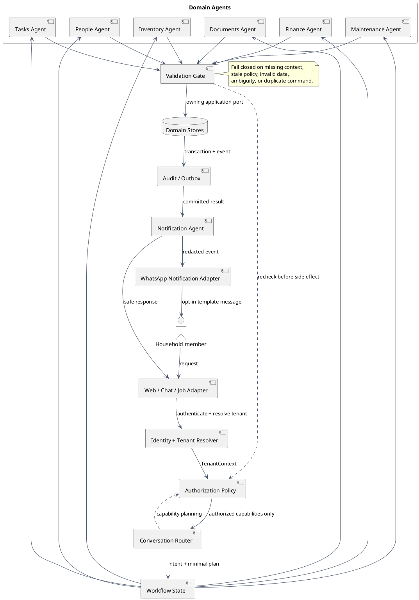
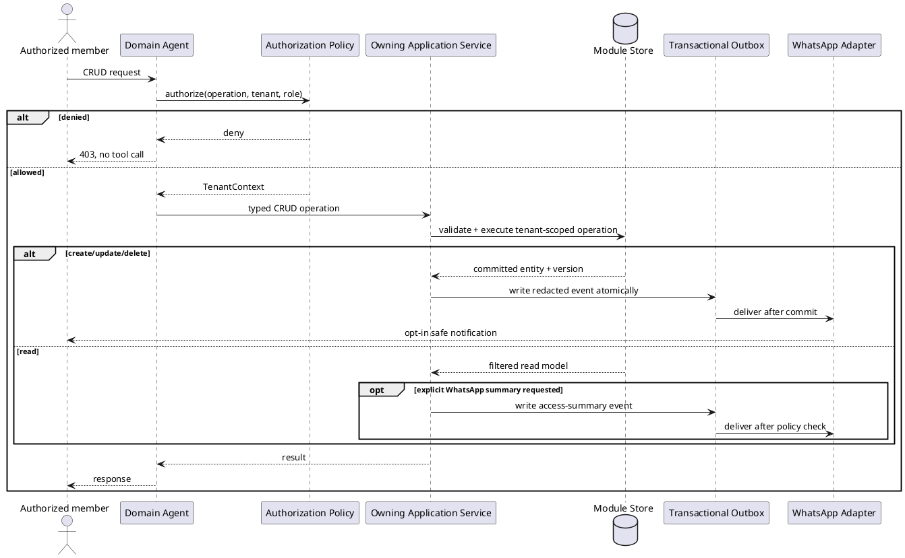
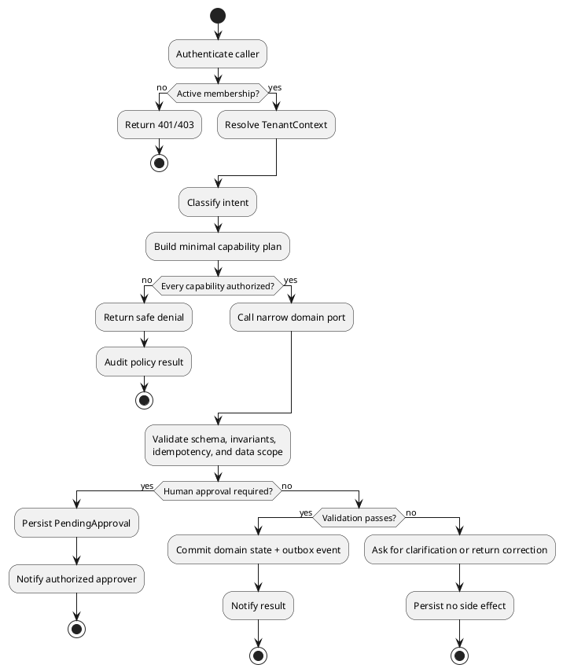

# Secure Multi-Agent Home Operations Workflow

This is the shared runtime workflow for chat, web actions, scheduled jobs, and document-triggered operations. It follows the reference pattern of state, router, tool agents, validation, conditional retry, and notification, but places identity and authorization before planning.

## Agent topology

- **Conversation Router**: classifies intent and builds a minimal plan.
- **Domain Agents**: Task, Inventory, Finance, Calendar, Maintenance, Document, and People agents.
- **Validation Gate**: checks schema, policy, tenant scope, invariants, idempotency, and confirmation state.
- **Notification Agent**: publishes a user-safe result after the owning module commits.
- **State Object**: holds the request envelope, plan, bounded results, validation status, and audit reference.

## Runtime contract

1. The adapter creates a correlation ID and authenticates the caller.
2. The tenant resolver selects one active household from memberships. Pending, removed, or suspended memberships stop here.
3. Authorization derives capabilities from role, resource, action, and domain policy. It does not trust the prompt, UI, or agent.
4. The router produces a bounded plan. The plan contains capability names and typed port calls, never repository operations.
5. Each domain agent receives a redacted `TenantContext` plus only the fields required by its port.
6. The validation gate rechecks authorization and validates the command inside the owning module.
7. The owner commits state and an outbox event atomically. Retries use a tenant-scoped idempotency key.
8. Notifications expose the outcome, not hidden records, credentials, raw prompts, or internal stack traces.

## CRUD and post-operation WhatsApp notification

Each domain agent calls its owning module with one of four typed operations: `create`, `read`, `update`, or `delete`. The module applies authorization and tenant filtering before the operation. Create, update, and delete write an outbox event in the same transaction as the state change. Read returns a role-filtered projection and creates an access event only when an explicit WhatsApp summary was requested.

## Failure and approval loop

## Security invariants

- No LLM provider, OCR service, or domain agent is called before authorization.
- Financial and private-document data are filtered before prompt construction.
- Tool outputs are treated as untrusted input and validated against typed schemas.
- Prompt injection in a document or chat message cannot grant a capability.
- Logs contain identifiers and policy outcomes, not access tokens, file contents, or full financial payloads.
- Scheduled workers reconstruct tenant context from the job envelope and never use an ambient tenant.
- WhatsApp delivery is asynchronous, redacted, opt-in, rate-limited, and independent of the domain transaction.
- A WhatsApp provider outage queues delivery without replaying or duplicating the CRUD operation.
