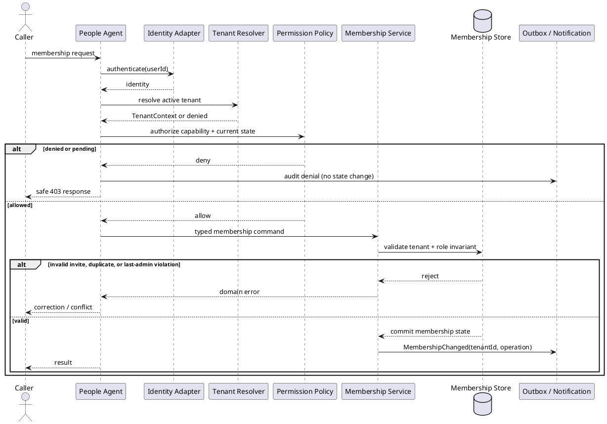

# People and Permissions Agent Workflow

## Purpose and ownership

The People Agent handles household creation, invites, membership review, role changes, and Admin transfer. It owns membership state and permission policy. It does not manage tasks, finance records, documents, or UI visibility.

**Inputs:** registration, invite code, join request, approve/reject request, role change, Admin transfer.

**Ports:** `Membership Commands`, `Membership Queries`, `Authorization Context`, `Notification Events`.

## CRUD operations

| CRUD | People-owned operation | WhatsApp event |
|---|---|---|
| Create | Create household, invite, or membership request | `HouseholdCreated`, `InviteCreated`, or `MembershipRequested` |
| Read | Read authorized household profile, members, invites, or permissions | Optional redacted membership summary when explicitly requested |
| Update | Approve/reject member, change role, or transfer Admin | `MembershipUpdated` or `AdminTransferred` |
| Delete | Revoke invite, remove member, or archive household | `InviteDeleted`, `MembershipDeleted`, or `HouseholdArchived` |

Each operation runs through the People application service. WhatsApp recipients are resolved from active memberships after the commit; invite codes, personal details, and role changes are never sent to unauthorized recipients.

## Secure workflow

## Domain rules and security checks

- The first household creator becomes Admin.
- Pending members have no household-resource access.
- Only an active Admin can approve members, change roles, or initiate Admin transfer.
- Admin transfer requires an Adult target and explicit confirmation.
- The last Admin cannot be removed or demoted.
- Invite codes are stored as hashes, expire, and are single-use or explicitly revoked.
- Membership queries return only the active tenant's records.

## Cohesion and coupling

The agent calls only the People application service. Other modules consume `Membership Queries`; they never read membership tables. Notifications are emitted after commit through the outbox, so an external delivery failure cannot roll back membership state.

## Approval and failure states

`Requested -> Pending -> Active | Rejected | Expired` and `Active -> Suspended | Removed` are domain transitions. A role change or Admin transfer remains `PendingApproval` until the owning policy and confirmation requirements are satisfied.
