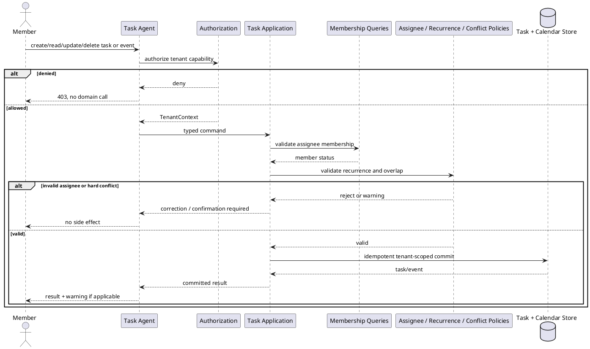

# Tasks and Schedule Agent Workflow

## Purpose and ownership

The Tasks Agent manages tasks, assignments, recurring chores, calendar events, and conflict warnings. It owns task and schedule invariants. Chat and forms both produce the same typed command.

**Ports:** `Task Commands`, `Task Queries`, `Membership Queries`, `Task Events`.

## CRUD operations

| CRUD | Tasks-owned operation | WhatsApp event |
|---|---|---|
| Create | Create task, recurrence rule, or calendar event | `TaskCreated`, `RecurrenceCreated`, or `CalendarEventCreated` |
| Read | Read assigned tasks, occurrences, or shared calendar | Optional redacted schedule summary on request |
| Update | Edit, complete, skip, reschedule, or reassign | `TaskUpdated` or `CalendarEventUpdated` |
| Delete | Cancel task, recurrence, or calendar event | `TaskDeleted` or `CalendarEventDeleted` |

The Task application service owns all CRUD validation. Every mutation carries an idempotency key and expected version; WhatsApp is notified only from the committed event, never directly by the agent.

## Security and domain rules

- The assignee must belong to the active household.
- Guest writes are denied before the Task Agent runs.
- Recurrence occurrences use an idempotency key derived from tenant, rule, and date.
- Calendar overlap is a warning by default; creating an event that requires explicit confirmation remains pending.
- Read models apply role visibility and `assigned-to-me` filtering at the application boundary.

## Cohesion and coupling

The agent does not parse recurrence logic or query the calendar store directly. It depends on the Task application port. Finance receives purchase costs or task-related amounts only through an explicit command port; no module imports Task tables.
