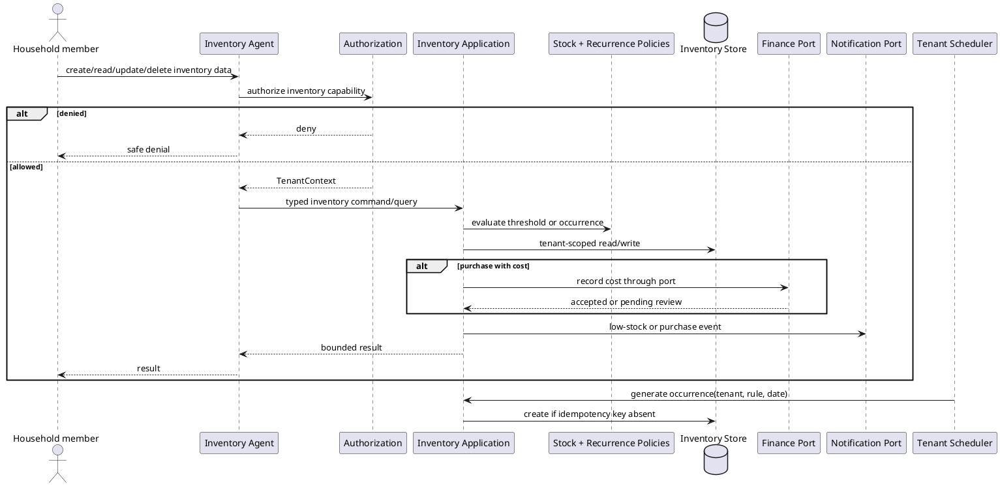

# Food and Inventory Agent Workflow

## Purpose and ownership

The Inventory Agent manages stock, low-stock queries, grocery lists, meal requirements, recurring commodities, and purchase completion. It owns stock state and occurrence idempotency.

**Ports:** `Inventory Commands`, `Inventory Queries`, `Membership Queries`, `Expense Commands`, `Inventory Events`.

## CRUD operations

| CRUD | Inventory-owned operation | WhatsApp event |
|---|---|---|
| Create | Add inventory item, grocery item, or commodity rule | `InventoryItemCreated`, `GroceryItemCreated`, or `CommodityRuleCreated` |
| Read | Read stock, low-stock items, grocery list, or occurrences | Optional redacted grocery/stock summary on request |
| Update | Adjust stock, edit item threshold, mark purchased, or skip occurrence | `StockUpdated`, `PurchaseCompleted`, or `GroceryItemUpdated` |
| Delete | Remove item, grocery entry, or recurrence rule | `InventoryItemDeleted` or `CommodityRuleDeleted` |

The Inventory application service performs CRUD and emits events after commit. WhatsApp messages contain item labels and safe status only; cost details are sent only to recipients authorized for Finance data.

## Security and domain rules

- Inventory data is scoped to one tenant and role-filtered before a response is generated.
- Recurring occurrence identity is `tenantId + ruleId + occurrenceDate`.
- Marking an occurrence purchased updates stock in the same domain transaction.
- Purchase cost crosses into Finance only as a typed `record cost` command.
- Low-stock notifications contain only the household's permitted item data.
- Recipe or meal-plan requests provide requirements through a query port; the agent does not read meal or task tables.

## Cohesion and coupling

Stock thresholds, grocery occurrences, and purchase state remain inside Inventory policies and aggregates. Finance, Notifications, and the orchestrator see events or narrow ports, preserving low coupling.
