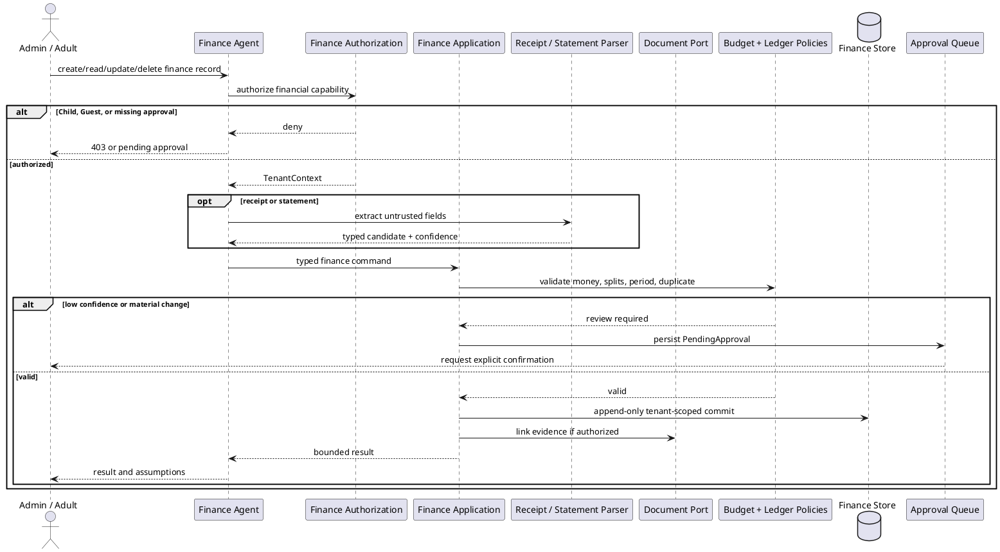

# Finance and Budget Agent Workflow

## Purpose and ownership

The Finance Agent is the household financial control plane. It handles ledger entries, receipt review, budgets, recurring bills, goals, debt projections, and bounded finance facts. It never initiates a payment or acts as regulated financial advice.

**Ports:** `Finance Commands`, `Finance Queries`, `Document Link`, `Inventory Cost`, `Notification Events`, `Orchestrator Finance Facts`.

## CRUD operations

| CRUD | Finance-owned operation | WhatsApp event |
|---|---|---|
| Create | Create account, transaction, budget, bill, goal, or debt plan | `FinancialRecordCreated` |
| Read | Read authorized balances, ledger, budget, forecast, or bill status | Explicit opt-in redacted summary only; never default full financial data |
| Update | Categorize, reconcile, revise budget, or change bill/goal metadata | `FinancialRecordUpdated` or `BudgetUpdated` |
| Delete | Void transaction, archive budget, or remove pending bill/goal | `FinancialRecordVoided` or `FinancialRecordArchived` |

Finance CRUD is append-only where accounting or audit rules require it. WhatsApp delivery is restricted to Admin/Adult recipients with finance permission, uses redacted templates, and never includes credentials, full account numbers, or unapproved financial details.

## Security and domain rules

- Authorization runs before OCR, import, parser, repository query, or financial read model access.
- Child and Guest receive no finance data, including through cross-domain answers.
- Money uses integer minor units and currency, never binary floating point.
- Posted transactions and audit events are append-only; corrections are compensating entries or revisions.
- Imported transactions are idempotent by provider account and provider transaction ID.
- Estimates and forecasts carry assumptions and confidence; they are never presented as accounting facts.
- High-value expenses, new recurring bills, account connections, and budget changes may require explicit approval.
- The agent cannot call bank transfer, payment, trading, or withdrawal tools.

## Cohesion and coupling

Finance owns ledger and budget calculations. Inventory sends only a cost command; Documents sends evidence through a link port; the orchestrator receives redacted read models. No agent receives raw finance tables or private account credentials.
