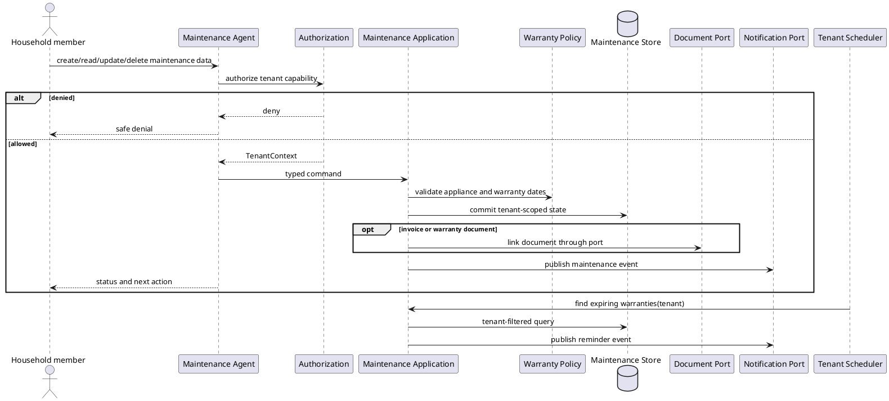

# Home and Maintenance Agent Workflow

## Purpose and ownership

The Maintenance Agent manages appliances, issues, repair history, service costs, and warranty reminders. It owns maintenance status and warranty calculations.

**Ports:** `Maintenance Commands`, `Maintenance Queries`, `Membership Queries`, `Document Link`, `Notification Events`.

## CRUD operations

| CRUD | Maintenance-owned operation | WhatsApp event |
|---|---|---|
| Create | Register appliance, report issue, or log repair | `ApplianceCreated`, `IssueCreated`, or `RepairCreated` |
| Read | Read issue status, appliance details, repair history, or warranties | Optional redacted maintenance summary on request |
| Update | Change issue status, assign owner, or update appliance/warranty data | `IssueUpdated` or `ApplianceUpdated` |
| Delete | Archive appliance, cancel issue, or remove a draft repair | `ApplianceArchived`, `IssueDeleted`, or `RepairDeleted` |

The Maintenance application service validates every CRUD operation and emits a tenant-scoped event after commit. WhatsApp receives only the minimum safe status and does not receive private invoices or document contents.

## Security and domain rules

- Issues, appliances, repairs, and warranty records always carry `tenantId`.
- Repair costs are not written directly to Finance; an explicit finance command is required.
- Warranty workers reconstruct tenant context from the scheduled job envelope.
- Document links are authorized in both the Maintenance and Document boundaries.
- A reminder is an event; the Maintenance Agent does not own email, push, or SMS credentials.

## Cohesion and coupling

Issue tracking, repair history, appliance state, and warranty policy live inside this module. Documents, Finance, and Notifications are replaceable ports, keeping the module cohesive and independently testable.
