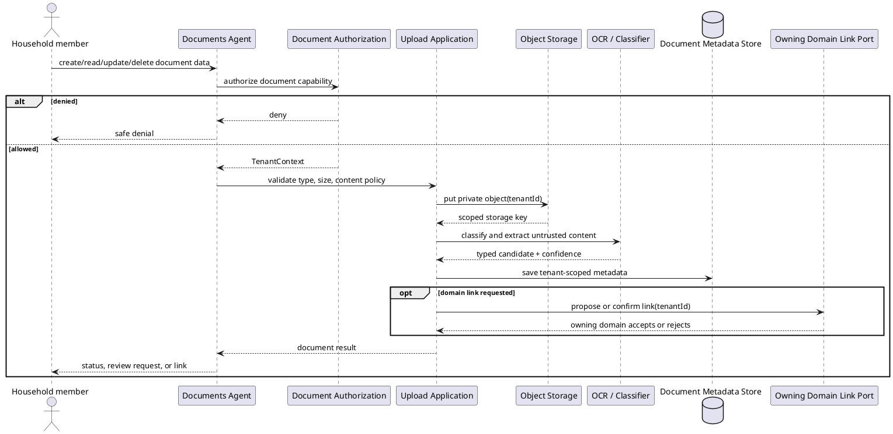

# Household Documents Agent Workflow

## Purpose and ownership

The Documents Agent manages private uploads, metadata, classification, extraction, authorized downloads, and links to owning domain records. It owns document metadata and storage references, not expenses, bills, or repairs.

**Ports:** `Document Commands`, `Document Queries`, `OCR / Extraction`, `Domain Record Link`, `Object Storage`.

## CRUD operations

| CRUD | Document-owned operation | WhatsApp event |
|---|---|---|
| Create | Upload document and create metadata | `DocumentCreated` |
| Read | List metadata, download authorized file, or inspect extraction | Optional redacted document-status summary; never file contents by default |
| Update | Reclassify, correct metadata, or link to an owning record | `DocumentUpdated` or `DocumentLinked` |
| Delete | Revoke access, archive metadata, or delete object when policy permits | `DocumentDeleted` or `DocumentArchived` |

Document CRUD requires authorization for both metadata and binary content. WhatsApp notifications contain document type, safe label, and processing state only; storage keys, OCR text, and private files are never included.

## Security and domain rules

- Metadata and binary objects are private by default.
- Object storage APIs require tenant context; a storage key alone is never sufficient for retrieval.
- File type, size, malware status, and content policy are checked before indexing or extraction.
- OCR and document text are untrusted input and cannot grant capabilities or override policy.
- Low-confidence extraction becomes `NeedsReview`; it does not silently create a financial or maintenance record.
- Authorized downloads use short-lived scoped access and are audited.

## Cohesion and coupling

The Documents Agent provides evidence and link proposals. The owning domain creates or changes the business record. This prevents a parser or LLM from becoming the owner of financial or maintenance invariants.
