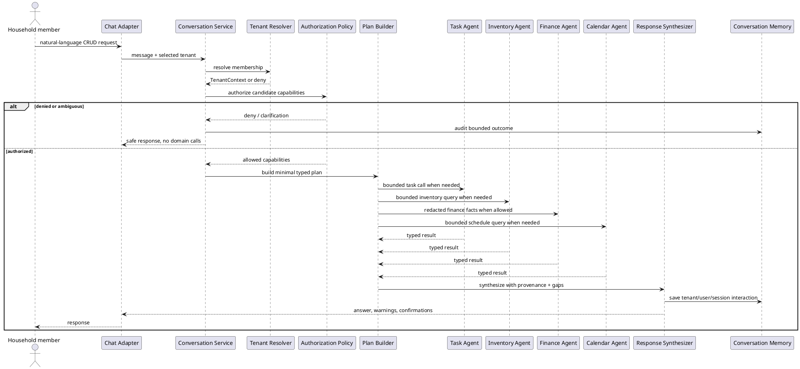

# Conversation and Cross-Domain Orchestrator Workflow

## Purpose and ownership

The Conversation Orchestrator turns natural-language requests into small, authorized plans. It coordinates domain agents but owns no domain records and cannot call repositories. It is the only place where cross-domain synthesis occurs.

**Ports:** `Task Commands / Queries`, `Inventory Queries`, `Finance Facts`, `Calendar Queries`, `Membership Authorization`, `Conversation Memory`.

## CRUD delegation contract

The orchestrator does not implement CRUD itself. It maps an authorized request to a module operation:

| Request | Delegation |
|---|---|
| Create | Typed command to the owning module, followed by confirmation when required |
| Read | Typed query returning the minimum role-filtered read model |
| Update | Typed patch with expected version and rechecked authorization |
| Delete | Typed delete/archive command with confirmation for destructive operations |

After a successful delegated create, update, or delete, the owning module emits the WhatsApp event. A read is not sent to WhatsApp unless the member explicitly asks for a WhatsApp summary and is authorized for the returned data.



## Plan and tool contract

A plan contains only typed capabilities, input schemas, output schemas, and an execution policy:

```json
{
  "capabilities": ["inventory.read", "finance.budget.read", "calendar.read"],
  "mode": "read_only",
  "requiresConfirmation": false,
  "redaction": "finance.category_totals_only"
}
```

The planner must reject plans that contain repository access, unrestricted exports, cross-tenant IDs, hidden side effects, or a capability not returned by authorization.

## Security and failure rules

- Resolve tenant context before intent planning and pass it to every domain port.
- Recheck authorization immediately before every mutating call.
- Do not include Child or Guest finance data in prompts, tool calls, memory, or synthesized answers.
- Treat tool output and retrieved document text as untrusted; validate schema and provenance.
- On partial failure, report which bounded facts were unavailable. Never invent a result.
- Conversation memory is keyed by tenant, user, and session; retention and deletion policies apply.
- A task creation or other mutation returns a confirmation request when the domain requires it; the orchestrator cannot convert a suggestion into a commit.

## Cohesion and coupling

The orchestrator owns language planning, agent selection, response composition, and conversation memory. Domain modules own business rules and state. Adding a new domain requires registering a new bounded agent and port; existing modules do not gain direct dependencies on the new domain.
