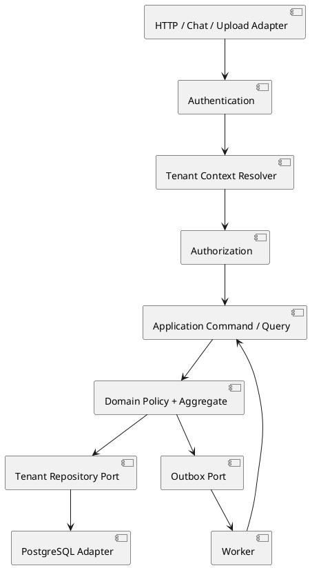

# Backend Module Design

## Architecture style

Use a modular monolith for the first backend release. Each bounded component is a module with:

- Application commands and queries.
- Domain entities and policies.
- Repository and integration ports.
- Infrastructure adapters.
- Tenant-aware tests.

The module boundary is a code boundary even though modules share a PostgreSQL instance. Direct cross-module table access is prohibited.

## Request flow



## Module contracts

### People & Permissions

- Commands: register household, create invite, join household, approve/reject member, change role, initiate/confirm Admin transfer.
- Queries: memberships for user, active membership for tenant, role and permission context, pending members.
- Invariants: first user is Admin; pending member has no access; only Admin manages roles; transfer target is Adult; last Admin cannot be removed.

### Tasks & Schedule

- Commands: create/update/complete task, create recurrence, create calendar event.
- Queries: assigned tasks, shared calendar, conflict check.
- Invariants: assignee belongs to tenant; recurrence occurrence is idempotent; calendar overlap produces a warning.

### Food & Inventory

- Commands: add grocery item, define commodity recurrence, complete or skip purchase occurrence, adjust stock.
- Queries: low stock, grocery list, meal requirements.
- Invariants: stock changes are tenant-scoped; recurring occurrence is unique by tenant/rule/date; cost is sent to Finance through a port.

### Finance & Budget

- Commands: record expense, create budget, create recurring bill.
- Queries: remaining budget, expenses for category/period, bill status.
- Invariants: Child and Guest are denied before execution; receipt links retain tenant scope; budget calculations are deterministic.

### Home & Maintenance

- Commands: report issue, log repair, register appliance.
- Queries: issue status, repair history, expiring warranties.
- Invariants: repairs and appliances cannot cross tenant boundaries; warranty jobs are tenant-scoped.

### Documents

- Commands: upload, classify, link to a domain record.
- Queries: list/download authorized documents.
- Invariants: metadata and object key are tenant-scoped; private storage access requires TenantContext.

### Conversation Orchestrator

- Commands: submit message.
- Queries: recent tenant/session interactions.
- Invariants: authorize each planned capability; use bounded query/command ports; store memory by tenant, user, and session.

## API conventions

- Version APIs under `/api/v1`.
- Use `/tenants/{tenantId}` for tenant-scoped resources.
- Keep identity-global operations, such as listing a user's household memberships, outside a tenant route.
- Return `404` for tenant-scoped resources that do not exist within the authorized tenant, avoiding cross-tenant existence leakage.
- Use `Idempotency-Key` for commands that may be retried.
- Return a correlation ID in every response and include it in logs/events.

## Error contract

```json
{
  "code": "TENANT_ACCESS_DENIED",
  "message": "The requested household is not accessible.",
  "correlationId": "uuid",
  "details": {}
}
```

Required mappings:

- `400`: malformed request.
- `401`: missing or invalid authentication.
- `403`: authenticated but not permitted in the active tenant.
- `404`: resource absent within the authorized tenant.
- `409`: idempotency or state conflict.
- `422`: business-rule violation.
- `429`: rate limit exceeded.
- `500`: unexpected server failure with no sensitive details.

## Async processing

Use a transactional outbox for domain events. Workers must:

1. Claim an event/job with a lease.
2. Reconstruct TenantContext from the event envelope.
3. Execute an idempotent handler.
4. Record success or retryable/permanent failure.
5. Preserve tenant and correlation identifiers in audit records.

Use Redis only for ephemeral coordination. PostgreSQL remains authoritative for state, outbox, and job idempotency.
