# Database Handoff — AI Home Manager

**Owner:** Database (Ananya)
**Consumers:** Backend team (APIs, auth, agents, RAG)
**Status:** Ready for integration

This document is the single reference the backend team needs to start building
on the database. It covers the schema (all tables, columns, enums, and
constraints), how to build and seed it, how to use it from code, and the key
design decisions that affect how you write queries.

---

## 1. TL;DR for the backend team

- **Stack:** SQLite3 + SQLAlchemy (matches the project proposal). Money is stored as integer minor units (cents), not floats.
- **Design:** **Single household, role-based.** There is **no `tenant_id`** anywhere. Access control is by member **role** (`Admin` / `Adult` / `Child` / `Guest`). See §6 for why.
- **Build it:** `pip install -r requirements.txt` then `python -m scripts.seed --reset`.
- **Use it:** `from app.db.base import get_session` and import models from `app.models`.
- **Seed logins:** four users, one per role, password `password123` (dev only). See §5.
- **RAG store:** a Chroma vector-store scaffold with role-aware retrieval lives in `app/rag/vector_store.py`. See §7.

---

## 2. Layout

```text
app/
├── config.py              # env-driven config (DATABASE_URL, JWT, OpenRouter, Chroma)
├── db/
│   ├── base.py            # engine, SessionLocal, get_session(), Base, SQLite pragmas
│   └── init_db.py         # create_all() / drop_all()
├── models/                # SQLAlchemy models (import these)
│   ├── enums.py
│   ├── people.py          # User, Membership, Invite
│   ├── tasks.py           # Task, RecurrenceRule, CalendarEvent
│   ├── inventory.py       # InventoryItem, GroceryItem, CommodityRule, PurchaseOccurrence
│   ├── finance.py         # Expense, Budget, RecurringBill
│   ├── maintenance.py     # Appliance, MaintenanceIssue, Repair
│   └── documents.py       # Document, DocumentLink, Conversation, AgentInteraction
├── auth/
│   └── passwords.py       # hash_password() / verify_password()
└── rag/
    └── vector_store.py    # Chroma scaffold (role-aware retrieval)

scripts/
└── seed.py                # create schema + seed one household
```

All models are re-exported from `app.models`, so you can do:

```python
from app.models import User, Membership, Task, Expense, HouseholdRole
```

---

## 3. Entity-Relationship Diagram

```plantuml
@startuml
hide methods
hide stereotypes
skinparam linetype ortho

' ---------- People & Permissions ----------
entity users {
  * user_id : varchar(36) <<PK>>
  --
  email : varchar(255) <<UQ>>
  password_hash : varchar(255)
  display_name : varchar(120)
  date_of_birth : date
  relationship_label : varchar(60)
  created_at : datetime
}
entity memberships {
  * membership_id : varchar(36) <<PK>>
  * user_id : varchar(36) <<FK, UQ>>
  --
  role : varchar
  status : varchar
  created_at : datetime
}
entity invites {
  * invite_id : varchar(36) <<PK>>
  --
  code_hash : varchar(255) <<UQ>>
  status : varchar
  expires_at : datetime
  created_by : varchar(36) <<FK>>
  created_at : datetime
}

' ---------- Tasks & Schedule ----------
entity recurrence_rules {
  * rule_id : varchar(36) <<PK>>
  --
  expression : varchar(255)
  next_occurrence : datetime
  active : boolean
  created_at : datetime
}
entity tasks {
  * task_id : varchar(36) <<PK>>
  --
  title : varchar(255)
  description : text
  assigned_to : varchar(36) <<FK>>
  created_by : varchar(36) <<FK>>
  due_at : datetime
  priority : varchar
  status : varchar
  recurrence_rule_id : varchar(36) <<FK>>
  created_at : datetime
}
entity calendar_events {
  * event_id : varchar(36) <<PK>>
  --
  title : varchar(255)
  starts_at : datetime
  ends_at : datetime
  owner_id : varchar(36) <<FK>>
  task_id : varchar(36) <<FK>>
  created_at : datetime
}

' ---------- Food & Inventory ----------
entity inventory_items {
  * item_id : varchar(36) <<PK>>
  --
  name : varchar(120)
  quantity : numeric(12,3)
  unit : varchar(30)
  low_stock_threshold : numeric(12,3)
  created_at : datetime
}
entity grocery_items {
  * grocery_item_id : varchar(36) <<PK>>
  --
  name : varchar(120)
  quantity : numeric(12,3)
  unit : varchar(30)
  purchased : boolean
  added_by : varchar(36) <<FK>>
  created_at : datetime
}
entity commodity_rules {
  * rule_id : varchar(36) <<PK>>
  --
  name : varchar(120)
  quantity : numeric(12,3)
  unit : varchar(30)
  preferred_brand : varchar(120)
  schedule : varchar(255)
  low_stock_threshold : numeric(12,3)
  active : boolean
  created_at : datetime
}
entity purchase_occurrences {
  * occurrence_id : varchar(36) <<PK>>
  * rule_id : varchar(36) <<FK>>
  --
  occurrence_date : date
  status : varchar
  item_id : varchar(36) <<FK>>
  created_at : datetime
  == unique ==
  (rule_id, occurrence_date)
}

' ---------- Finance & Budgeting ----------
entity expenses {
  * expense_id : varchar(36) <<PK>>
  --
  amount_minor : bigint
  currency : char(3)
  category : varchar(80)
  description : varchar(255)
  occurred_at : datetime
  recorded_by : varchar(36) <<FK>>
  document_id : varchar(36) <<FK>>
  created_at : datetime
}
entity budgets {
  * budget_id : varchar(36) <<PK>>
  --
  category : varchar(80)
  limit_minor : bigint
  currency : char(3)
  period : varchar
  period_start : date
  period_end : date
  created_at : datetime
}
entity recurring_bills {
  * bill_id : varchar(36) <<PK>>
  --
  payee : varchar(120)
  expected_amount_minor : bigint
  currency : char(3)
  category : varchar(80)
  due_at : datetime
  recurrence : varchar(60)
  created_at : datetime
}

' ---------- Home & Maintenance ----------
entity appliances {
  * appliance_id : varchar(36) <<PK>>
  --
  name : varchar(120)
  brand : varchar(120)
  model : varchar(120)
  purchased_at : date
  warranty_ends_at : date
  created_at : datetime
}
entity maintenance_issues {
  * issue_id : varchar(36) <<PK>>
  --
  description : text
  status : varchar
  priority : varchar
  reported_by : varchar(36) <<FK>>
  accountable_to : varchar(36) <<FK>>
  appliance_id : varchar(36) <<FK>>
  created_at : datetime
}
entity repairs {
  * repair_id : varchar(36) <<PK>>
  --
  appliance_id : varchar(36) <<FK>>
  serviced_at : date
  provider : varchar(160)
  cost_minor : bigint
  currency : char(3)
  notes : text
  logged_by : varchar(36) <<FK>>
  created_at : datetime
}

' ---------- Documents + Conversation ----------
entity documents {
  * document_id : varchar(36) <<PK>>
  --
  document_type : varchar
  storage_key : varchar(512)
  original_filename : varchar(255)
  mime_type : varchar(120)
  uploaded_by : varchar(36) <<FK>>
  created_at : datetime
}
entity document_links {
  * link_id : varchar(36) <<PK>>
  * document_id : varchar(36) <<FK>>
  --
  linked_domain : varchar(40)
  linked_record_id : varchar(36)
  created_at : datetime
  == unique ==
  (linked_domain, linked_record_id)
}
entity conversations {
  * conversation_id : varchar(36) <<PK>>
  --
  session_id : varchar(36)
  user_id : varchar(36) <<FK>>
  started_at : datetime
}
entity agent_interactions {
  * interaction_id : varchar(36) <<PK>>
  * conversation_id : varchar(36) <<FK>>
  --
  session_id : varchar(36)
  user_id : varchar(36) <<FK>>
  intent : varchar(120)
  message : text
  response : text
  created_at : datetime
}

users ||--o| memberships
users ||--o{ invites
users ||--o{ tasks : assigned_to / created_by
users ||--o{ calendar_events : owner
users ||--o{ grocery_items : added_by
users ||--o{ expenses : recorded_by
users ||--o{ conversations
users ||--o{ agent_interactions

recurrence_rules ||--o{ tasks
tasks ||--o| calendar_events

commodity_rules ||--o{ purchase_occurrences
inventory_items ||--o{ purchase_occurrences

appliances ||--o{ maintenance_issues
appliances ||--o{ repairs

documents ||--o{ document_links
documents ||--o{ expenses : source receipt
conversations ||--o{ agent_interactions
@enduml
```



---

## 4. Table reference (by domain)

Every primary key is a string UUID (`varchar(36)`), generated by the app.
Every table has a `created_at` timestamp. Enum columns are stored as strings.

### People & Permissions

**`users`** — a person who can authenticate (identity is global, not role-scoped).
| Column | Type | Notes |
|---|---|---|
| user_id | varchar(36) PK | |
| email | varchar(255) | **unique**, indexed — JWT is issued against this |
| password_hash | varchar(255) | see `app/auth/passwords.py` |
| display_name | varchar(120) | |
| date_of_birth | date | nullable; derive age from this, do not store a static age |
| relationship_label | varchar(60) | nullable |

**`memberships`** — links a user to the household with a role + status. One per user.
| Column | Type | Notes |
|---|---|---|
| membership_id | varchar(36) PK | |
| user_id | varchar(36) FK→users | **unique** (one membership per user) |
| role | enum | `Admin` / `Adult` / `Child` / `Guest` |
| status | enum | `Pending` / `Active` / `Rejected` / `Suspended` / `Removed` (default `Pending`) |

**`invites`** — invite codes (hashed at rest) to join the household.
| Column | Type | Notes |
|---|---|---|
| invite_id | varchar(36) PK | |
| code_hash | varchar(255) | **unique** — store the hash, never the raw code |
| status | enum | `Active` / `Used` / `Expired` / `Revoked` |
| expires_at | datetime | nullable |
| created_by | varchar(36) FK→users | nullable |

### Tasks & Schedule

**`recurrence_rules`** — schedule expression for recurring tasks.
`rule_id` PK · `expression` (e.g. `FREQ=WEEKLY;BYDAY=FR`) · `next_occurrence` · `active` bool

**`tasks`** — a household task.
`task_id` PK · `title` · `description` · `assigned_to` FK→users (nullable) · `created_by` FK→users · `due_at` · `priority` (`Low`/`Normal`/`High`) · `status` (`Open`/`InProgress`/`Done`/`Cancelled`) · `recurrence_rule_id` FK

**`calendar_events`** — shared calendar; overlap is checked by the app on create.
`event_id` PK · `title` · `starts_at` (indexed) · `ends_at` · `owner_id` FK→users · `task_id` FK→tasks

### Food & Inventory

**`inventory_items`** — `item_id` PK · `name` · `quantity` numeric · `unit` · `low_stock_threshold`
**`grocery_items`** — `grocery_item_id` PK · `name` · `quantity` · `unit` · `purchased` bool · `added_by` FK
**`commodity_rules`** — recurring commodities. `rule_id` PK · `name` · `quantity` · `unit` · `preferred_brand` · `schedule` (e.g. `DAILY`) · `low_stock_threshold` · `active`
**`purchase_occurrences`** — dated occurrences generated from a rule.
`occurrence_id` PK · `rule_id` FK · `occurrence_date` · `status` (`Pending`/`Purchased`/`Skipped`) · `item_id` FK→inventory_items.
**Unique `(rule_id, occurrence_date)`** — makes the scheduler idempotent (no duplicate occurrence per day).

### Finance & Budgeting

> **Money is integer minor units (cents) + a 3-char currency code.** Never use floats for money.

**`expenses`** — `expense_id` PK · `amount_minor` bigint · `currency` · `category` (indexed) · `description` · `occurred_at` (indexed) · `recorded_by` FK · `document_id` FK→documents (optional receipt link)
**`budgets`** — `budget_id` PK · `category` (indexed) · `limit_minor` · `currency` · `period` (`Monthly`/`Weekly`/`Custom`) · `period_start` · `period_end`
**`recurring_bills`** — `bill_id` PK · `payee` · `expected_amount_minor` · `currency` · `category` · `due_at` (indexed) · `recurrence` (e.g. `MONTHLY`)

### Home & Maintenance

**`appliances`** — `appliance_id` PK · `name` · `brand` · `model` · `purchased_at` · `warranty_ends_at` (indexed, for reminders)
**`maintenance_issues`** — `issue_id` PK · `description` · `status` (`Open`/`InProgress`/`Resolved`/`Closed`) · `priority` · `reported_by` FK · `accountable_to` FK · `appliance_id` FK
**`repairs`** — `repair_id` PK · `appliance_id` FK · `serviced_at` · `provider` · `cost_minor` · `currency` · `notes` · `logged_by` FK

### Documents + Conversation / Memory

**`documents`** — metadata only; the binary lives in object storage.
`document_id` PK · `document_type` (`Receipt`/`Bill`/`Warranty`/`Other`) · `storage_key` · `original_filename` · `mime_type` · `uploaded_by` FK
**`document_links`** — polymorphic link from a document to a domain record.
`link_id` PK · `document_id` FK · `linked_domain` (allow-list this: `finance`, `maintenance`, ...) · `linked_record_id`.
**Unique `(linked_domain, linked_record_id)`** — a given record is linked at most once; one document may have many links.
**`conversations`** — `conversation_id` PK · `session_id` (indexed) · `user_id` FK
**`agent_interactions`** — one chat turn, for memory + RAG. `interaction_id` PK · `conversation_id` FK · `session_id` (indexed) · `user_id` FK · `intent` · `message` · `response`

---

## 5. Enums (stored as strings)

| Enum | Values |
|---|---|
| HouseholdRole | `Admin`, `Adult`, `Child`, `Guest` |
| MembershipStatus | `Pending`, `Active`, `Rejected`, `Suspended`, `Removed` |
| InviteStatus | `Active`, `Used`, `Expired`, `Revoked` |
| TaskStatus | `Open`, `InProgress`, `Done`, `Cancelled` |
| Priority | `Low`, `Normal`, `High` |
| OccurrenceStatus | `Pending`, `Purchased`, `Skipped` |
| BudgetPeriod | `Monthly`, `Weekly`, `Custom` |
| IssueStatus | `Open`, `InProgress`, `Resolved`, `Closed` |
| DocumentType | `Receipt`, `Bill`, `Warranty`, `Other` |

Import from `app.models` (e.g. `from app.models import HouseholdRole`).

---

## 6. Build, seed, and use

### Install
```bash
pip install -r requirements.txt
```

### Create schema + seed sample data
```bash
python -m scripts.seed --reset     # drops, recreates, and seeds
python -m scripts.seed             # create-if-missing, then seed
```
This writes `ai_home_manager.db` at the project root (configurable via `DATABASE_URL`).

### Seed accounts (development only, password = `password123`)
| Email | Name | Role |
|---|---|---|
| admin@home.test | Ravi | Admin |
| adult@home.test | Meera | Adult |
| child@home.test | Aarav | Child |
| guest@home.test | Sam | Guest |

Plus a little sample data in every domain (tasks, a calendar event, inventory,
grocery, a commodity rule + occurrence, a budget/expense/bill, an appliance +
issue, and a document + link + conversation).

### Use from code
```python
from sqlalchemy import select
from app.db.base import get_session
from app.models import User, Task, HouseholdRole

session = get_session()
try:
    admin = session.scalars(
        select(User).where(User.email == "admin@home.test")
    ).first()
    role = admin.membership.role          # HouseholdRole.ADMIN
    tasks = session.scalars(select(Task)).all()
finally:
    session.close()
```

### Passwords
```python
from app.auth.passwords import hash_password, verify_password
h = hash_password("secret")
verify_password("secret", h)   # True
```
Uses bcrypt when `passlib[bcrypt]` is installed; falls back to stdlib PBKDF2
otherwise. Both hash formats verify correctly, so no migration is needed when
bcrypt becomes available.

### SQLite settings (applied automatically per connection)
`foreign_keys = ON`, `journal_mode = WAL`, `busy_timeout = 5000`,
`synchronous = NORMAL`. See `app/db/base.py`.

---

## 7. RAG vector store (role-aware)

`app/rag/vector_store.py` is a Chroma scaffold that sits **beside** SQLite.
SQLite is the system of record; Chroma holds embedded text chunks for
retrieval. It is intentionally small and ready for the agent/RAG team.

The important contract: **every chunk carries a `min_role` and `source_domain`,
and `query()` filters retrieval by the caller's role.** A `Child` query can
never retrieve `finance`/`document` chunks meant for `Adult`/`Admin`. Role
ranking: `Guest(0) < Child(1) < Adult(2) < Admin(3)`.

```python
from app.rag.vector_store import get_default_store
from app.models import HouseholdRole

store = get_default_store()
store.add_texts(
    ids=["doc-1#chunk-0"],
    texts=["Electricity bill for March is $80, due on the 6th."],
    source_domain="finance",
    min_role=HouseholdRole.ADULT,          # hidden from Child/Guest
)
# A Child asking this gets no finance chunk back:
store.query("how much is the electric bill", role=HouseholdRole.CHILD)
```

Requires `chromadb` (in `requirements.txt`). The import is lazy, so the SQL
database works without it installed.

---

## 8. Design decisions the backend team must know

1. **Single household, role-based — no `tenant_id`.**
   The project proposal scopes the system to **one household** whose members
   have different roles. The design docs in `docs/design/` describe a
   multi-tenant SaaS with `tenant_id` on every table; **that version was not
   built.** Do **not** add `tenant_id` filters to queries — there is one
   household. Authorization is by **role** (`memberships.role`), which is your
   "Authorize" step before any LLM/data access.

2. **Money = integer minor units + currency.** All `*_minor` columns are cents
   (or the currency's smallest unit). Convert for display only.

3. **String UUID primary keys** everywhere, for portability if you ever move to
   Postgres. PKs are generated in the app, not the DB.

4. **Documents store metadata only.** The actual file goes to object storage;
   `documents.storage_key` is the reference.

5. **Idempotency constraints** exist on `purchase_occurrences(rule_id, occurrence_date)`
   and `document_links(linked_domain, linked_record_id)` — respect them in
   upserts.

6. **Enforcement is the backend's job.** The DB stores roles and constraints;
   it does not enforce RBAC (e.g. "Child cannot read finance"). That check
   belongs in the Authorize step / service layer the backend team owns.
