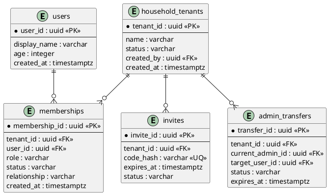
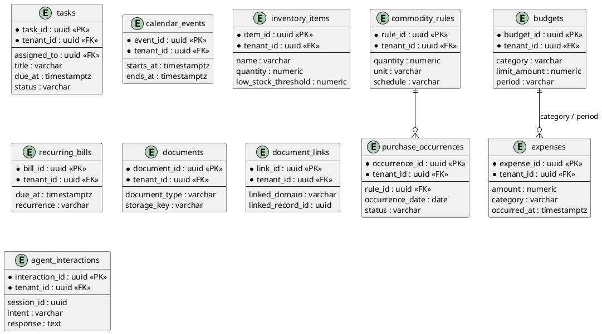

# Relational Schema

The schema is organized by bounded component ownership. Modules share one PostgreSQL database in the MVP, but each module owns its tables and accesses another module only through ports or events.

## Identity and tenant tables

## Tenant-owned domain tables

## Platform tables

- `outbox_messages`: `event_id`, `tenant_id`, event type, payload, status, attempts, lease timestamp, created timestamp.
- `notifications`: `notification_id`, `tenant_id`, recipient user, event type, delivery status, provider reference.
- `job_runs`: `job_run_id`, `tenant_id`, job type, idempotency key, status, started/finished timestamps.
- `audit_events`: `audit_id`, `tenant_id`, actor user, action, resource type/id, result, correlation ID, timestamp.

## Required constraints and indexes

### Constraints

- `memberships`: unique `(tenant_id, user_id)`.
- `memberships`: role must be one of `Admin`, `Adult`, `Child`, `Guest`; status must be one of `Pending`, `Active`, `Rejected`, `Suspended`, `Removed`.
- `purchase_occurrences`: unique `(tenant_id, rule_id, occurrence_date)`.
- `outbox_messages`: unique `(tenant_id, event_id)`.
- `job_runs`: unique `(tenant_id, job_type, idempotency_key)`.
- `document_links`: unique `(tenant_id, linked_domain, linked_record_id)` where the domain permits one link.
- Cross-tenant foreign keys must be rejected. Composite tenant-aware references are preferred where supported.

### Indexes

- Every tenant-owned table: `(tenant_id, created_at)` or its primary query equivalent.
- Membership lookup: `(user_id, tenant_id, status)`.
- Task list: `(tenant_id, assigned_to, status, due_at)`.
- Calendar overlap: `(tenant_id, starts_at, ends_at)`.
- Inventory low stock: `(tenant_id, name)` with a query comparing quantity and threshold.
- Finance status: `(tenant_id, category, occurred_at)`.
- Bills and warranties: `(tenant_id, due_at)` and `(tenant_id, warranty_ends_at)`.
- Outbox polling: `(status, available_at, created_at)`.

## Migration rules

- Use versioned forward-only migrations.
- Add nullable columns before backfilling and enforcing `NOT NULL`.
- Add indexes concurrently for large production tables.
- Test migrations with at least two tenants and cross-tenant negative cases.
- Never run a migration that assumes tenant data is globally unique unless the constraint explicitly includes `tenant_id`.
