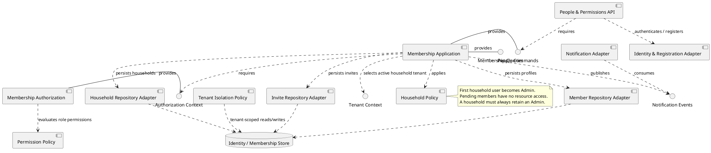
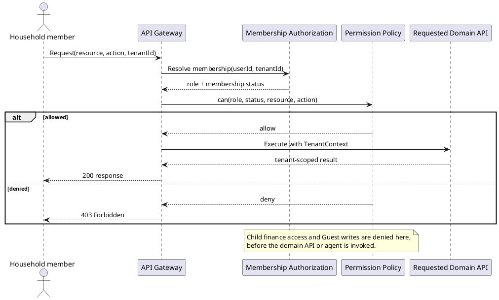
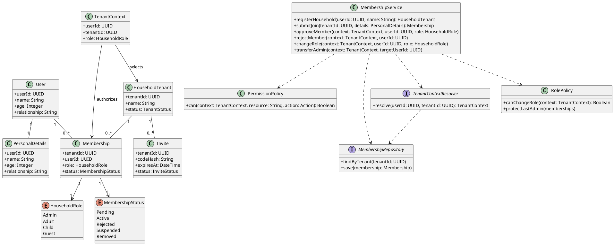
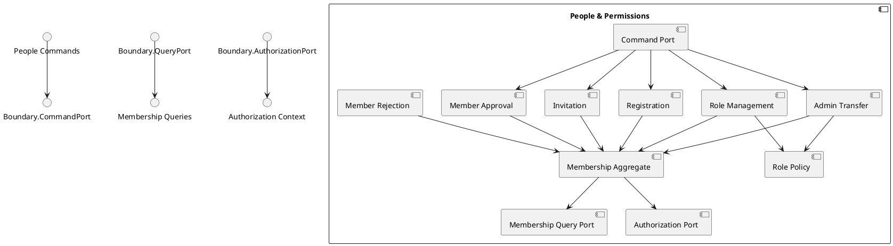
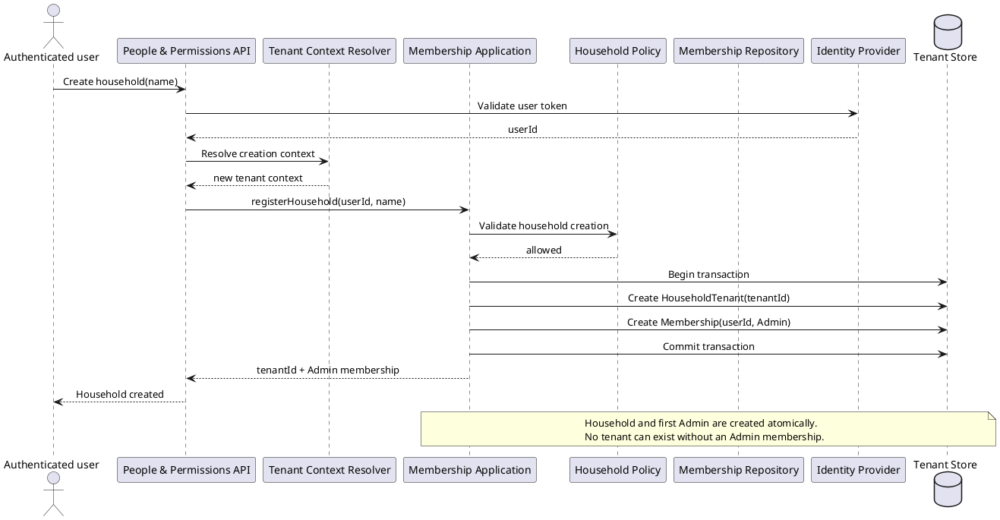
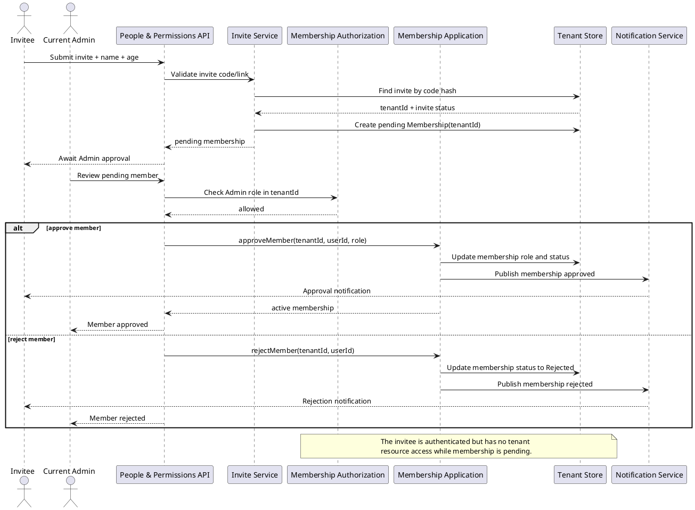
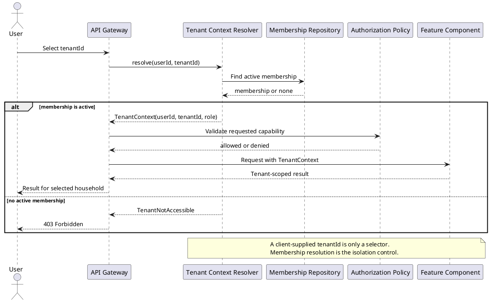
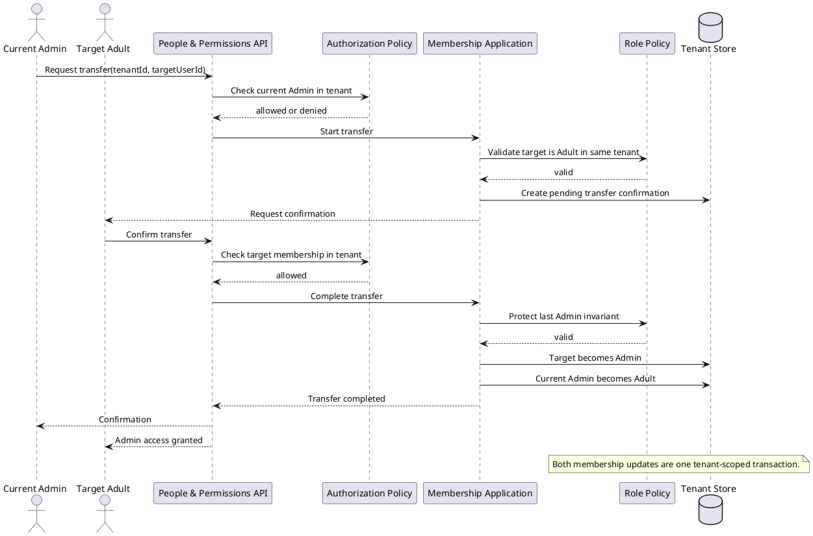
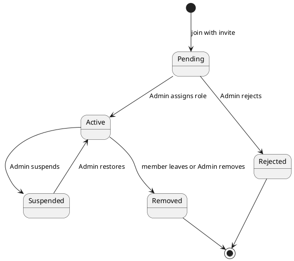

# People and Permissions Component

## Story coverage

- US-1.1: create a household and make the first user Admin.
- US-1.2: join with an invite code or link and provide name and age.
- US-1.3: Admin reviews pending members and assigns a role.
- US-1.4: Admin changes roles.
- US-1.5: Admin transfer with confirmation.
- US-1.6 and US-1.7: role-scoped access for Child and Guest.

## Component diagram

## Responsibilities and rules

The component owns identity-linked member data, household tenants, memberships, invites, and permission decisions. It does not own tasks, finance records, or UI decisions. A user may create multiple household tenants and may hold memberships in multiple tenants; each operation selects one active tenant. Other components consume the `Membership Queries` interface instead of reading this store directly. The application service implements registration, invitation, approval, rejection, role changes, and admin transfer behind one command interface; this keeps the domain policy independent of HTTP and persistence details.

### Enforce role-scoped access

## Role and permission contract

Authorization is evaluated against both the active `tenantId` and the member's role. A pending membership has no household-resource permission.

| Role/state | Allowed profile and household actions | Allowed shared-resource actions | Restricted actions |
|---|---|---|---|
| Admin / Active | Review pending members, assign or change roles, create invites, transfer Admin | Read and write household resources | Cannot remove or demote the last Admin |
| Adult / Active | Read own profile and membership | Read and write according to each domain's Adult policy | Cannot perform Admin-only membership operations |
| Child / Active | Read own profile, own tasks, and shared calendar | Read permitted schedule data | Finance, budget, bill, Admin, and other members' private data return 403 |
| Guest / Active | Read own profile | Read-only access to today's schedule and tasks | All writes/deletes and finance, budget, bill, and Admin operations return 403 |
| Any / Pending | View own approval status | None | No household data or resource access |

The policy is enforced before task, calendar, inventory, finance, document, or maintenance handlers run. UI visibility is not a substitute for this check.

## Tenant-aware class structure

`HouseholdTenant` is the tenant root. Membership and invite records are tenant-scoped, and the service cannot mutate a membership without a resolved `TenantContext`. The repository interface follows DIP and makes tenant filtering part of the persistence contract.

## Internal structure

The public component exposes command, membership-query, and authorization ports. Registration, invitation, approval, role management, and admin transfer are separate internal components and share the membership aggregate and role policy rather than bypassing them.

## Behavior diagrams

### Create a household tenant

### Join and approve a household tenant

### Switch active household tenant

### Transfer household administration

### Membership lifecycle

These behavior diagrams use sequence diagrams for interactions and a state machine for membership lifecycle. Every flow carries a tenant identifier, resolves membership before access, and commits tenant-owned changes atomically.
