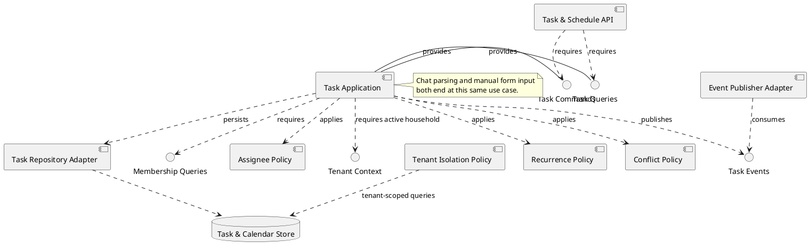
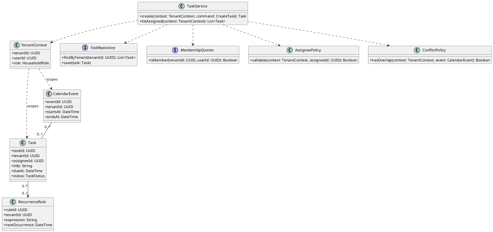
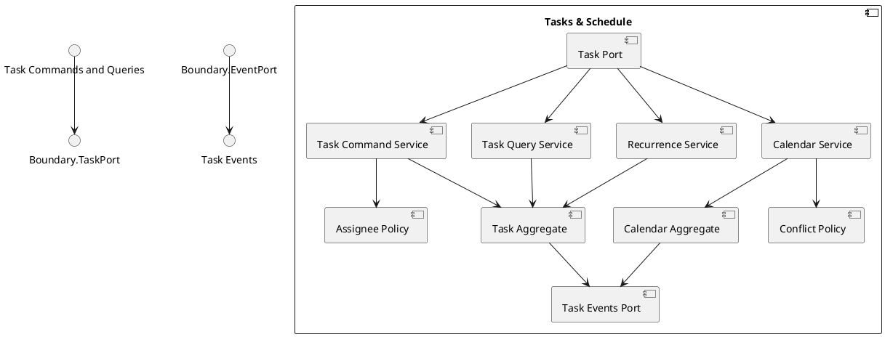
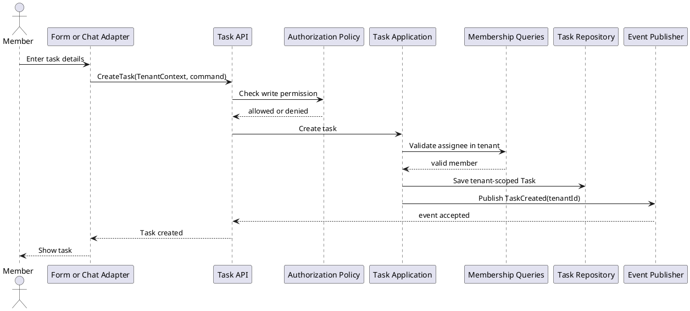

# Tasks and Schedule Component

## Story coverage

- US-2.1: create a task through chat.
- US-2.2: create a task through a manual form.
- US-2.3: view assigned tasks.
- US-2.4: recurring chores.
- US-2.5 and US-2.6: shared calendar and conflict warnings.

## Component diagram

## Responsibilities and rules

- Chat and form adapters normalize input into one `CreateTask` command.
- `Assignee Policy` verifies that the assignee belongs to the same household.
- `Task Query Handler` applies the caller's visibility filter, including assigned-to-me views.
- `Recurrence Handler` creates idempotent occurrences for weekly chores.
- `Calendar Handler` checks time overlap before accepting a new event and returns a warning when needed.
- Guest writes are rejected by the shared authorization boundary before handlers execute.

The component owns tasks, calendar events, recurrence definitions, and conflict checks. It does not parse natural language itself; the chat adapter or orchestrator supplies a validated command.

## Tenant-aware class structure

Tasks, events, and recurrence rules carry `tenantId`. `TaskService` receives the tenant context explicitly, while repository and membership ports prevent assignments or queries from crossing household boundaries.

## Internal structure

Manual form input and chat input enter through the same `Task Port`. The internal services keep command handling, read filtering, recurrence, and calendar conflict detection independently replaceable.

## Behavior diagram: create a task

The manual and chat channels converge on one command, preserving consistent validation and tenant isolation.
