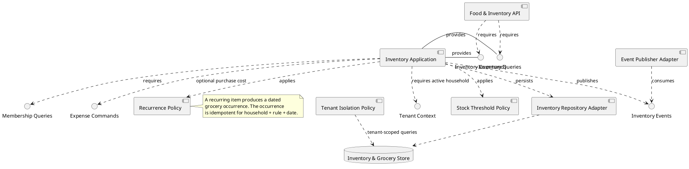
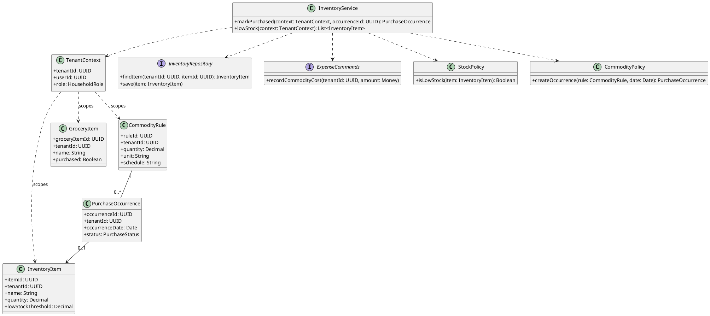
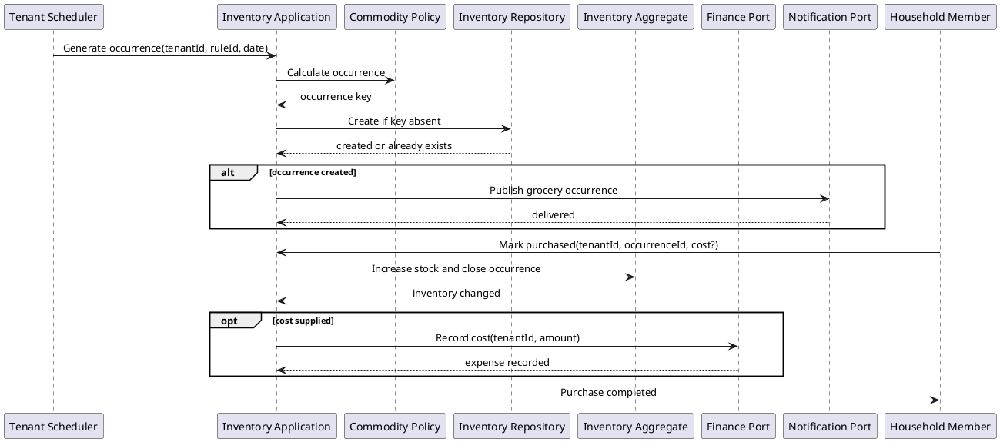
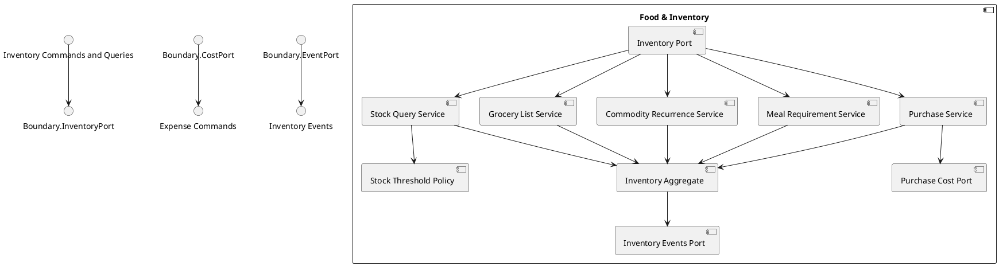

# Food and Inventory Component

## Story coverage

- US-3.1: low-stock alerts.
- US-3.2: ask what is running low.
- US-3.3: build a grocery list from a recipe or meal plan.
- US-3.4: mark grocery items purchased.
- US-3.5: recurring daily commodities such as milk, bread, or eggs.
- US-3.6: update inventory and optionally record purchase cost.

## Component diagram

## Responsibilities and rules

- `Inventory Query Handler` returns low-stock and out-of-stock read models.
- `Grocery List Handler` manages one-off items and recipe or meal-plan requirements.
- `Commodity Rule Handler` stores quantity, unit, preferred brand, threshold, and daily/custom recurrence.
- `Purchase Handler` marks an occurrence purchased or skipped, updates stock, and optionally calls the Finance expense port.
- `Stock Threshold Policy` emits a low-stock notification without coupling inventory to a notification provider.

The component owns inventory and grocery state. Finance receives a purchase-cost command through a port; it does not receive direct access to the inventory database.

## Tenant-aware class structure

Recurring milk, bread, or egg rules generate occurrences using a tenant-scoped idempotency key. Inventory updates and optional expenses are emitted only for the active household tenant.

## Behavior diagram: recurring commodity purchase

The occurrence key includes tenant, recurrence rule, and date, making scheduled jobs idempotent independently for every household.

## Internal structure

The boundary separates ordinary grocery items, recurring commodities, meal requirements, stock queries, and purchase completion. All mutations pass through the inventory aggregate, which keeps stock updates and idempotent occurrence handling consistent.
