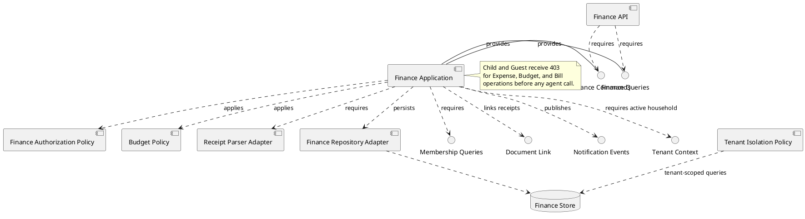
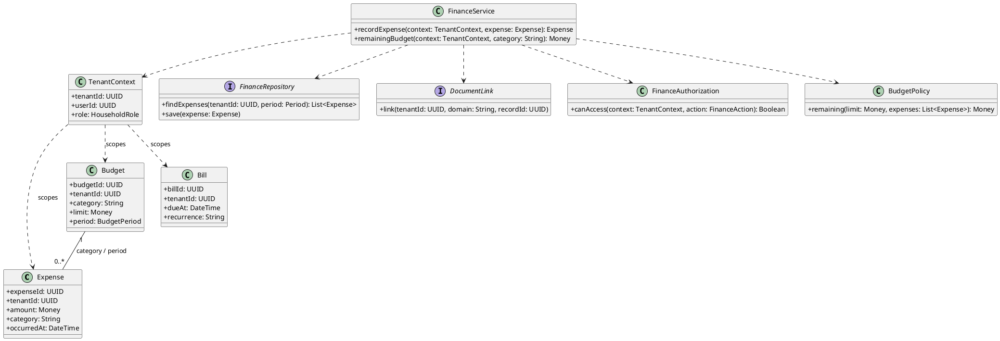
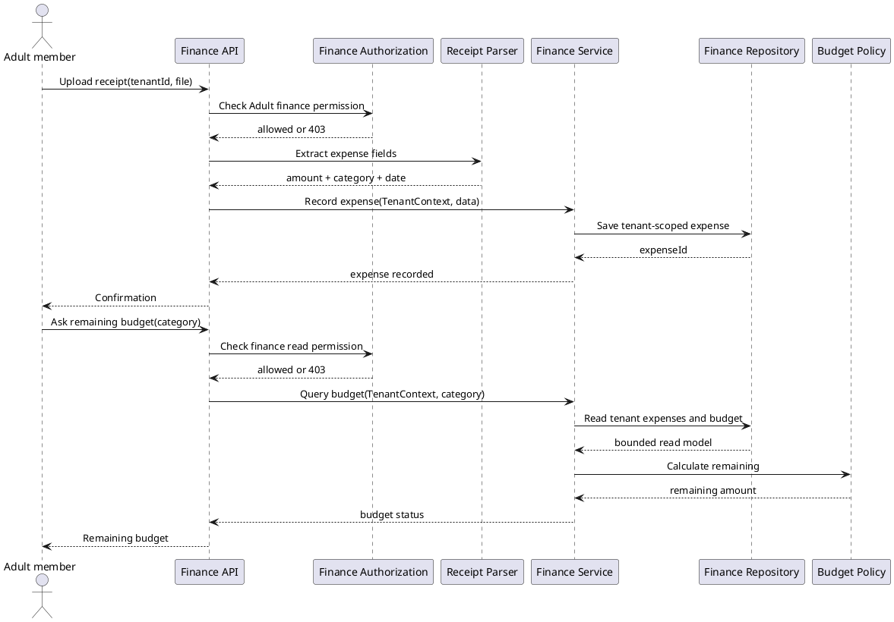
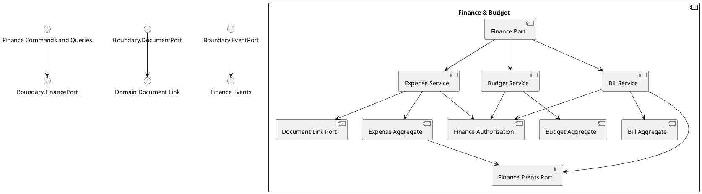

# Finance and Budget Component

## Story coverage

- US-4.1: parse a receipt and create a linked expense.
- US-4.2: check remaining budget.
- US-4.3: recurring bill reminders.
- US-4.4: block Child and Guest finance access before agent execution.
- US-3.6: accept optional costs from recurring commodity purchases.

## Component diagram

## Responsibilities and rules

- `Finance Authorization Policy` is mandatory for every finance command and query.
- `Expense Handler` accepts parsed receipt data, manual expense data, and purchase-cost commands through separate input ports.
- `Document Link Port` associates a receipt document with `linked_domain` and `linked_record_id`.
- `Budget Query Handler` calculates remaining budget from approved expenses and configured limits.
- `Bill Handler` manages recurring bills and emits due reminders through a notification port.

The component owns expenses, budgets, and bills. It must never rely on the client hiding sensitive data.

## Tenant-aware class structure

Finance entities always carry `tenantId`, and `FinanceAuthorization` evaluates the role inside that tenant. A Child or Guest from one household cannot access another household's financial records by changing an identifier.

## Behavior diagram: receipt expense and budget query

Authorization is performed before both receipt parsing and budget reads, preventing protected finance work from being reached by Child or Guest members.

## Internal structure

The finance boundary keeps expense, budget, and bill operations separate while sharing one authorization component. This makes the Child and Guest restriction enforceable for every internal path, not only for HTTP endpoints.
