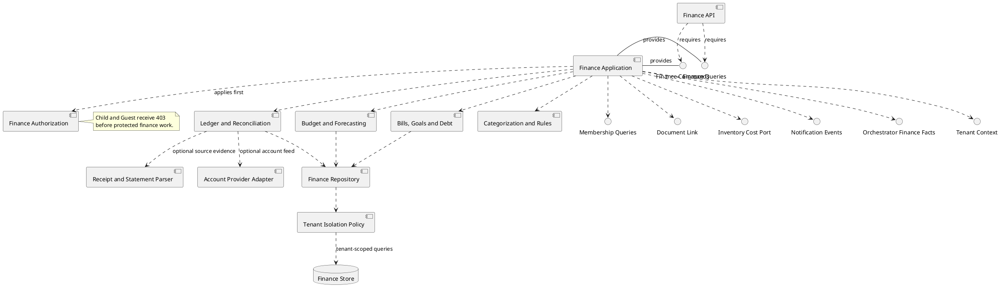
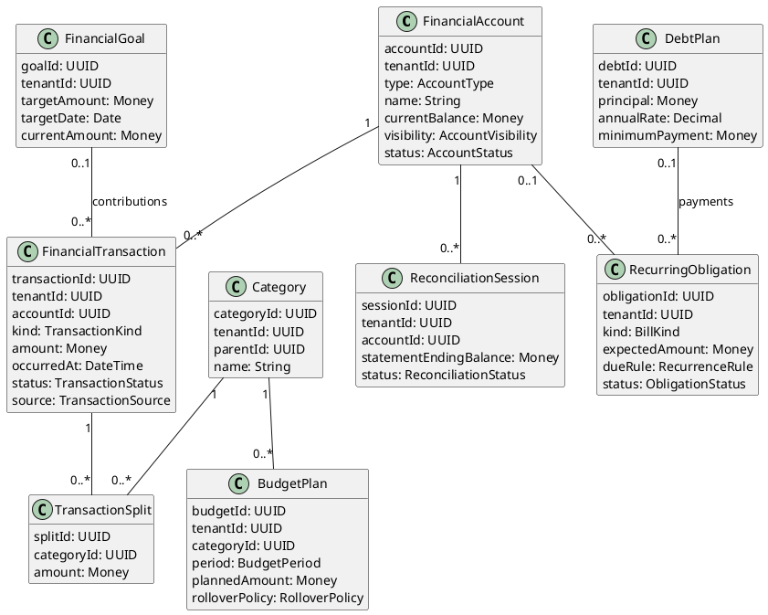
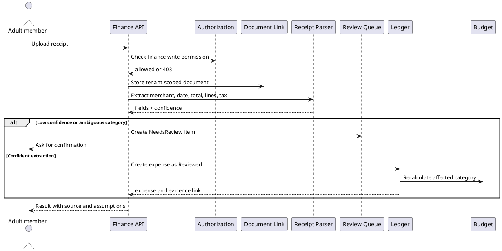

# Finance and Budget Component

The Finance component is the household's financial control plane. It records money coming in and going out, plans future obligations, explains current status, and gives authorized household members enough context to make decisions. It is not a bank, payment processor, tax adviser, or investment adviser. External accounts and documents are evidence sources; the household ledger remains the system of record for decisions made inside AI Home Manager.

## Design goals

- Give Adults and Admins one understandable view of household cash flow.
- Make every financial answer traceable to transactions, accounts, budgets, bills, goals, or documents.
- Support both manual entry and imported data without creating duplicate records.
- Keep financial data tenant-scoped and hidden from Child and Guest roles.
- Turn recurring household operations into reliable reminders and forecasts.
- Require confirmation for material changes and never execute a payment from a chat response.

## Story coverage

| Story | Component behavior |
|---|---|
| US-3.6 | Record the cost of a recurring commodity purchase and update budget and inventory projections. |
| US-4.1 | Parse a receipt, request review when confidence is low, create an expense, and link the source document. |
| US-4.2 | Answer remaining-budget and cash-flow questions with category, period, and source breakdowns. |
| US-4.3 | Forecast recurring bills and notify authorized members before the due date. |
| US-4.4 | Enforce finance permissions before any handler, agent, parser, importer, or financial read model runs. |
| US-6.2 | Provide bounded finance facts to the orchestrator for cross-domain affordability answers. |
| US-6.3 | Store finance-related conversation interactions without exposing protected values to unauthorized roles. |

## Scope

### Core capabilities

1. **Accounts and balances**: cash, bank, credit card, loan, cash wallet, investment, and other household accounts; manual accounts are first-class and do not require bank connectivity.
2. **Income and transactions**: income, expenses, transfers, refunds, reimbursements, fees, interest, adjustments, and split transactions.
3. **Categories and merchants**: configurable category tree, merchant normalization, labels, tax-deductible flag, and rules for future classification.
4. **Budgets**: monthly or custom-period category budgets, rollover policy, planned income, committed bills, and actual-versus-plan reporting.
5. **Bills and subscriptions**: recurring obligations, variable amounts, due-date windows, autopay metadata, renewal warnings, and missed-payment state.
6. **Goals and reserves**: emergency fund, planned purchase, annual expense, education, or other savings target with progress and suggested contribution.
7. **Debt**: liability balances, interest rate, minimum payment, due date, payoff target, and payoff projections. The module does not make lending decisions.
8. **Household allocation**: shared, personal, reimbursable, and child allowance classifications; contribution tracking without revealing private accounts to other members.
9. **Documents and evidence**: receipts, bills, statements, warranty-linked costs, and expense source references.
10. **Reconciliation and audit**: imported-versus-recorded matching, review queues, correction history, and immutable audit events.
11. **Insights**: cash-flow forecast, upcoming obligations, unusual spending, subscription changes, budget risk, and scenario answers.

### Explicit non-goals for the MVP

- Initiating bank transfers, bill payments, card payments, trades, or withdrawals.
- Holding credentials or raw bank passwords.
- Providing regulated financial, tax, credit, or investment advice.
- Automatically changing a category, budget, bill, or goal without an authorized confirmation.
- Treating an AI-generated estimate as an accounting fact.

## Permission model

Finance permission is evaluated against the active household membership, not a client-supplied `tenantId` or user role.

| Role | Read finance | Create/edit finance | Approve/import/connect | Admin settings |
|---|---:|---:|---:|---:|
| Admin | Yes | Yes | Yes | Yes |
| Adult | Yes | Yes, subject to household approval rules | No by default; may submit for review | No |
| Child | No | No | No | No |
| Guest | No | No | No | No |

Households may enable an approval policy for high-value expenses, new recurring bills, account connections, or budget changes. Child allowances and personal contributions are represented as narrow projections; they never grant access to the underlying private account or household financial history.

Authorization is the first operation in every finance use case. A denied request returns `403` without invoking an AI agent, OCR parser, account provider, repository query, or financial notification workflow.

## Component diagram

## Domain model

### Financial invariants

- Store money as integer minor units plus an ISO currency code; never use binary floating point for amounts.
- A transaction has one household, one source, one effective date, and an explicit status such as `Pending`, `Posted`, `Reviewed`, `Voided`, or `NeedsReview`.
- A transaction with splits must satisfy `sum(splits) = transaction amount` in the same currency.
- Transfers link two accounts and do not count as income or expense in reports.
- Refunds reverse or adjust the original category rather than silently creating income.
- Imported data is idempotent by provider account plus provider transaction identifier; manual records can be linked to an imported record during reconciliation.
- A budget is a plan, not a balance. Remaining budget is calculated from the selected period, included transaction statuses, rollover policy, and pending commitments.
- Future forecasts are labeled as estimates and include their assumptions and confidence.
- Posted transactions and audit events are append-only. Corrections create a compensating entry or a new revision, never destructive mutation.
- Every stored financial value and every query result is tenant-scoped.

## Core workflows

### Receipt to reviewed expense

### Imported transaction reconciliation

1. The provider adapter fetches only accounts authorized by the household and stores provider cursors encrypted at rest.
2. New records enter `Pending` and are normalized without overwriting the provider description.
3. Categorization rules propose merchant, category, splits, and recurring-obligation matches.
4. The system matches against manual entries using amount, date window, account, and merchant similarity.
5. An Adult may review a proposed match; an Admin may approve according to household policy.
6. The reconciliation session compares the statement ending balance with posted ledger balance and reports unresolved differences.

### Budget and cash-flow answer

The Budget service returns a structured fact set before an AI response is generated:

- selected period and timezone;
- available account balance and accounts included;
- posted income and expenses;
- pending transactions and committed recurring obligations;
- category budget, actual, remaining, and projected overage;
- goal contributions and debt minimums;
- confidence, missing data, and calculation timestamp.

The orchestrator may explain this fact set, but may not invent amounts or silently broaden the account scope. A response such as "Can we afford Saturday's dinner?" must state whether it means current available cash, budgeted grocery capacity, or both.

### Recurring bills and subscriptions

- Detect or manually define a recurring obligation with expected amount range, cadence, due-date rule, payee, category, and source.
- Generate an occurrence for each period with `Forecast`, `DueSoon`, `Paid`, `Skipped`, `Overdue`, or `Uncertain` state.
- Notify the responsible Adult or Admin at configurable offsets, with quiet hours and deduplication.
- Detect price changes, duplicate subscriptions, missed occurrences, and renewal windows.
- Link payment evidence to the occurrence and update the next forecast only after review or a reliable provider match.

### Goals and debt

Goals reserve money conceptually; they do not move money. Contributions are transfers or allocations linked to a goal. Debt projections use principal, rate, minimum payment, extra payment, fees, and payment cadence, and show assumptions. The system can compare payoff scenarios but must label them as educational projections.

## API and application contracts

All endpoints require an authenticated active household context. Request and response examples use logical names; the implementation may expose REST or another transport.

### Commands

| Command | Permission | Result |
|---|---|---|
| `CreateManualTransaction` | Adult/Admin | Draft or reviewed transaction with idempotency key. |
| `ReviewTransaction` | Adult/Admin | Category, split, merchant, evidence, and status decision. |
| `CreateBudgetPlan` / `AdjustBudgetPlan` | Adult/Admin | Versioned plan with effective period and audit event. |
| `CreateRecurringObligation` | Adult/Admin | Bill or subscription rule and first forecast occurrence. |
| `CreateGoal` / `RecordGoalContribution` | Adult/Admin | Goal projection or linked allocation. |
| `CreateDebtPlan` / `RecordDebtPayment` | Adult/Admin | Debt projection and payment evidence. |
| `StartReconciliation` / `ResolveReconciliationItem` | Admin, or Adult if enabled | Reconciled account period and exceptions. |
| `ConnectAccount` / `DisconnectAccount` | Admin | Provider consent state and sync job; no raw credentials stored. |

### Queries

| Query | Output |
|---|---|
| `GetFinanceOverview` | Cash, income, spending, budget health, upcoming obligations, goals, and data freshness. |
| `GetTransactions` | Filtered, paginated transactions with source, status, category, and split information. |
| `GetBudgetStatus` | Planned, actual, pending, remaining, forecast, rollover, and explanation. |
| `GetCashFlowForecast` | Time-bucketed inflows, outflows, commitments, balance range, assumptions, and confidence. |
| `GetUpcomingObligations` | Bills, subscriptions, debt payments, renewals, and overdue items. |
| `GetGoalsAndDebt` | Progress, contribution history, payoff scenarios, and next action. |
| `GetReconciliationStatus` | Statement balance, ledger balance, matched items, and unresolved differences. |
| `GetOrchestratorFinanceFacts` | Minimal facts for an authorized cross-domain answer; no raw private-account data. |

## Storage model

The Finance component owns the following tenant-scoped tables. The existing shared schema should be extended rather than treating `expenses`, `budgets`, and `recurring_bills` as the complete model.

| Table | Purpose |
|---|---|
| `financial_accounts` | Manual or connected account metadata, balance snapshot, currency, visibility, and sync state. |
| `account_connections` | Provider connection metadata, consent, cursor, error state, and encrypted external identifiers. |
| `financial_transactions` | Canonical income, expense, transfer, refund, fee, interest, and adjustment records. |
| `transaction_splits` | Category-level allocation for one transaction. |
| `financial_categories` | Tenant category tree and system category mapping. |
| `categorization_rules` | Merchant and description rules with priority and review history. |
| `budget_plans` | Versioned category or envelope plans, periods, limits, and rollover policy. |
| `budget_allocations` | Optional goal/reserve allocations and approved adjustments. |
| `recurring_obligations` | Bills, subscriptions, debt payments, and expected income rules. |
| `obligation_occurrences` | Generated period occurrence, forecast, actual link, and notification state. |
| `financial_goals` | Target, date, current allocation, status, and visibility. |
| `debt_plans` | Liability terms and payoff assumptions. |
| `reconciliation_sessions` | Account-period comparison and closing state. |
| `reconciliation_items` | Imported/manual match proposals and resolution decisions. |
| `finance_review_items` | Low-confidence OCR, categorization, duplicate, and approval queues. |
| `finance_snapshots` | Daily or period summaries used for fast dashboards and trend charts. |

Required constraints include unique `(tenant_id, provider_account_id)`, unique `(tenant_id, provider_transaction_id)`, unique `(tenant_id, obligation_id, occurrence_date)`, tenant-aware foreign keys, non-negative category allocations where applicable, and indexes on `(tenant_id, account_id, occurred_at)`, `(tenant_id, category_id, occurred_at)`, `(tenant_id, status, due_at)`, and `(tenant_id, review_status, created_at)`.

## Entity relationship diagram

The diagram shows Finance-owned entities and their relationships to shared household, document, and audit tables. `tenant_id` is present on every tenant-owned entity even where the relationship is shown through another foreign key.

```plantuml
@startuml
hide methods
hide stereotypes
skinparam linetype ortho
skinparam entity {
  BackgroundColor White
  BorderColor 555555
}

entity household_tenants {
  * tenant_id : uuid <<PK>>
  --
  name : varchar
  currency : char(3)
  timezone : varchar
}

entity memberships {
  * membership_id : uuid <<PK>>
  * tenant_id : uuid <<FK>>
  * user_id : uuid <<FK>>
  --
  role : varchar
  status : varchar
}

entity financial_accounts {
  * account_id : uuid <<PK>>
  * tenant_id : uuid <<FK>>
  --
  name : varchar
  account_type : varchar
  currency : char(3)
  current_balance_minor : bigint
  visibility : varchar
  status : varchar
}

entity account_connections {
  * connection_id : uuid <<PK>>
  * tenant_id : uuid <<FK>>
  * account_id : uuid <<FK>>
  --
  provider : varchar
  provider_account_id : varchar
  sync_cursor : varchar
  consent_status : varchar
  last_synced_at : timestamptz
}

entity financial_categories {
  * category_id : uuid <<PK>>
  * tenant_id : uuid <<FK>>
  * parent_id : uuid <<FK>>
  --
  name : varchar
  category_type : varchar
}

entity financial_transactions {
  * transaction_id : uuid <<PK>>
  * tenant_id : uuid <<FK>>
  * account_id : uuid <<FK>>
  --
  kind : varchar
  amount_minor : bigint
  currency : char(3)
  occurred_at : timestamptz
  status : varchar
  source : varchar
  provider_transaction_id : varchar
}

entity transaction_splits {
  * split_id : uuid <<PK>>
  * tenant_id : uuid <<FK>>
  * transaction_id : uuid <<FK>>
  * category_id : uuid <<FK>>
  --
  amount_minor : bigint
  note : varchar
}

entity categorization_rules {
  * rule_id : uuid <<PK>>
  * tenant_id : uuid <<FK>>
  --
  matcher : json
  category_id : uuid <<FK>>
  priority : integer
  enabled : boolean
}

entity budget_plans {
  * budget_id : uuid <<PK>>
  * tenant_id : uuid <<FK>>
  * category_id : uuid <<FK>>
  --
  period_start : date
  period_end : date
  planned_amount_minor : bigint
  rollover_policy : varchar
  version : integer
}

entity budget_allocations {
  * allocation_id : uuid <<PK>>
  * tenant_id : uuid <<FK>>
  * budget_id : uuid <<FK>>
  * goal_id : uuid <<FK>>
  --
  amount_minor : bigint
  allocated_at : timestamptz
}

entity recurring_obligations {
  * obligation_id : uuid <<PK>>
  * tenant_id : uuid <<FK>>
  * account_id : uuid <<FK>>
  --
  kind : varchar
  payee : varchar
  expected_amount_minor : bigint
  due_rule : varchar
  status : varchar
}

entity obligation_occurrences {
  * occurrence_id : uuid <<PK>>
  * tenant_id : uuid <<FK>>
  * obligation_id : uuid <<FK>>
  * transaction_id : uuid <<FK>>
  --
  occurrence_date : date
  expected_amount_minor : bigint
  state : varchar
}

entity financial_goals {
  * goal_id : uuid <<PK>>
  * tenant_id : uuid <<FK>>
  --
  name : varchar
  target_amount_minor : bigint
  target_date : date
  current_amount_minor : bigint
  status : varchar
}

entity debt_plans {
  * debt_id : uuid <<PK>>
  * tenant_id : uuid <<FK>>
  * account_id : uuid <<FK>>
  --
  principal_minor : bigint
  annual_rate : decimal
  minimum_payment_minor : bigint
  payoff_target_date : date
}

entity reconciliation_sessions {
  * session_id : uuid <<PK>>
  * tenant_id : uuid <<FK>>
  * account_id : uuid <<FK>>
  --
  statement_ending_balance_minor : bigint
  period_end : date
  status : varchar
}

entity reconciliation_items {
  * item_id : uuid <<PK>>
  * tenant_id : uuid <<FK>>
  * session_id : uuid <<FK>>
  * transaction_id : uuid <<FK>>
  --
  match_status : varchar
  provider_reference : varchar
  difference_minor : bigint
}

entity finance_review_items {
  * review_id : uuid <<PK>>
  * tenant_id : uuid <<FK>>
  * transaction_id : uuid <<FK>>
  --
  review_type : varchar
  confidence : decimal
  status : varchar
  resolved_by : uuid <<FK>>
}

entity documents {
  * document_id : uuid <<PK>>
  * tenant_id : uuid <<FK>>
  --
  document_type : varchar
  storage_key : varchar
}

entity document_links {
  * link_id : uuid <<PK>>
  * tenant_id : uuid <<FK>>
  * document_id : uuid <<FK>>
  --
  linked_domain : varchar
  linked_record_id : uuid
}

entity audit_events {
  * audit_id : uuid <<PK>>
  * tenant_id : uuid <<FK>>
  * actor_user_id : uuid <<FK>>
  --
  action : varchar
  resource_type : varchar
  resource_id : uuid
  result : varchar
  occurred_at : timestamptz
}

household_tenants ||--o{ memberships
household_tenants ||--o{ financial_accounts
household_tenants ||--o{ financial_categories
household_tenants ||--o{ financial_transactions
household_tenants ||--o{ budget_plans
household_tenants ||--o{ recurring_obligations
household_tenants ||--o{ financial_goals
household_tenants ||--o{ debt_plans

financial_accounts ||--o| account_connections
financial_accounts ||--o{ financial_transactions
financial_accounts ||--o{ recurring_obligations
financial_accounts ||--o{ debt_plans
financial_accounts ||--o{ reconciliation_sessions

financial_categories ||--o{ financial_categories : parent
financial_categories ||--o{ transaction_splits
financial_categories ||--o{ budget_plans
financial_categories ||--o{ categorization_rules
financial_transactions ||--o{ transaction_splits
financial_transactions ||--o{ obligation_occurrences
financial_transactions ||--o{ reconciliation_items
financial_transactions ||--o{ finance_review_items

budget_plans ||--o{ budget_allocations
financial_goals ||--o{ budget_allocations
recurring_obligations ||--o{ obligation_occurrences
reconciliation_sessions ||--o{ reconciliation_items
documents ||--o{ document_links
financial_transactions ||--o{ document_links : linked finance record
household_tenants ||--o{ documents
household_tenants ||--o{ audit_events
@enduml
```

### ERD relationship rules

- Every Finance-owned row has a `tenant_id`; composite tenant-aware foreign keys must prevent cross-household references.
- `financial_transactions` is the canonical ledger record. Budgets, bills, goals, debt, documents, and reconciliation records reference it rather than copying its amount as a new financial fact.
- `transaction_splits` supports one transaction across multiple categories; the split total must equal the transaction total.
- `obligation_occurrences.transaction_id` is nullable until a payment is matched or reviewed.
- `document_links` remains polymorphic because Documents is a shared component; `linked_domain` must be allow-listed and validated by the owning component.
- `budget_allocations.goal_id` is nullable because an allocation can be a normal category budget adjustment or a goal reserve.
- Account provider identifiers are unique only within a tenant and provider connection; they must never be used as global identifiers.
- Deleting a financial record is prohibited after posting. Voiding, correction, and audit events preserve the history.

## Events and integrations

### Published events

- `FinanceTransactionRecorded`
- `FinanceTransactionReviewed`
- `BudgetPlanChanged`
- `BudgetRiskDetected`
- `RecurringObligationDueSoon`
- `RecurringObligationOverdue`
- `SubscriptionAmountChanged`
- `FinancialGoalProgressed`
- `DebtPaymentRecorded`
- `AccountSyncFailed`
- `ReconciliationCompleted`

Events contain `eventId`, `tenantId`, actor or system source, occurred time, schema version, correlation ID, and an idempotency key. They must not contain raw account credentials or unnecessary private transaction details.

### Consumed ports

- **Documents**: link receipts, bills, statements, and warranties using `linked_domain` and `linked_record_id`.
- **Inventory**: receive commodity purchase cost and provide category-aware grocery totals.
- **Notifications**: deliver due, budget, sync, review, and anomaly notifications.
- **Membership**: resolve role and authorized household member references.
- **Calendar**: optionally coordinate bill due dates and household planning.
- **Conversation orchestrator**: expose only authorized, bounded finance facts.

## AI behavior and safety

The Finance Agent may classify, summarize, extract, compare, and explain. It may not bypass authorization, invent missing values, execute payments, alter posted history, or make high-impact financial recommendations without explicit scope and confirmation.

Every AI result includes:

- intent and requested period;
- records and documents used;
- calculation version and timestamp;
- assumptions, missing data, and confidence;
- proposed mutations separately from completed mutations;
- confirmation requirement for any write.

Examples:

- "How much is left in groceries?" calls `GetBudgetStatus` and returns planned, posted, pending, and projected values separately.
- "Log this receipt" creates a review item when merchant, total, currency, or date is uncertain.
- "Can we afford Saturday's dinner?" combines authorized inventory, finance, and calendar facts and explains the affordability definition.
- "Cancel the streaming service" may identify the subscription and draft a reminder, but cannot cancel it.

## Security, privacy, and reliability

- Encrypt provider tokens and sensitive account identifiers; do not log them.
- Redact full account numbers and sensitive transaction descriptions from application logs and AI prompts where possible.
- Use least-privilege provider scopes and show connected-account consent and disconnect controls.
- Apply rate limits to exports, account connection attempts, OCR, and AI finance queries.
- Record access and mutation audit events with actor, resource, result, and correlation ID.
- Use outbox delivery for notifications and idempotent jobs for imports, recurring occurrence generation, and forecast snapshots.
- Make provider outages visible as stale-data state; never present a stale balance as current.
- Support export and deletion workflows subject to document retention and audit requirements.
- Display a clear product boundary: informational planning, not regulated financial advice.

## Delivery plan

### MVP

1. Manual accounts, manual transactions, categories, receipt linking, and finance authorization.
2. Budget plans, remaining-budget query, recurring bills, notifications, and audit events.
3. Transaction splits, refunds, transfers, review queue, and basic cash-flow forecast.
4. Finance facts for US-6.2 and safe conversational memory for US-6.3.

### Next increment

- Optional account aggregation adapter with consent, sync cursors, deduplication, and reconciliation.
- Subscriptions, goals, debt plans, household reimbursements, and approval workflows.
- Anomaly detection, budget suggestions, price-change alerts, and richer reports.

### Later

- Investment holdings and net-worth snapshots as read-only integrations.
- Multi-currency household reporting, tax export, and jurisdiction-specific financial education.
- Scenario planning for irregular income and large household purchases.

## Research notes and sources

The design was informed by the following current public references, consulted on 2026-09-15:

- [YNAB](https://www.ynab.com/) emphasizes assigning money to a purpose before spending, flexible planning, savings goals, debt payoff, and household collaboration. This supports budget plans, goals, and explainable allocations rather than only retrospective expense charts.
- [Quicken](https://www.quicken.com/) presents a broad personal-finance model spanning banking, budgets, investments, bills, taxes, net worth, cash-flow projections, and reports. This supports treating accounts, obligations, and forecasts as first-class capabilities while keeping investment and tax features later-phase integrations.
- [Plaid Investments](https://plaid.com/products/investments/) demonstrates the importance of separating account, holding, and transaction data for connected financial sources. This supports provider adapters and explicit freshness and source metadata instead of coupling the domain to one provider.
- [Consumer Financial Protection Bureau credit resources](https://www.consumerfinance.gov/consumer-tools/credit-reports-and-scores/) stress reviewing financial records for errors and disputing inaccurate information. This supports reconciliation, review queues, immutable corrections, source evidence, and clear separation between imported facts and household decisions.

These sources are product and consumer-education references, not implementation dependencies or financial advice. Provider selection, legal review, data-retention policy, and jurisdiction-specific compliance remain separate decisions.
