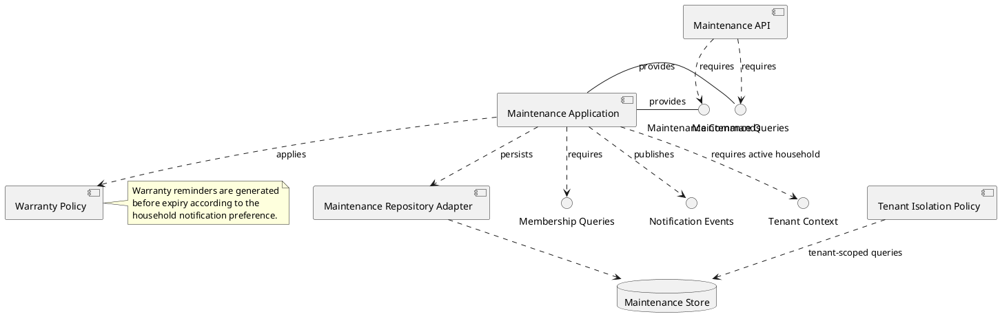
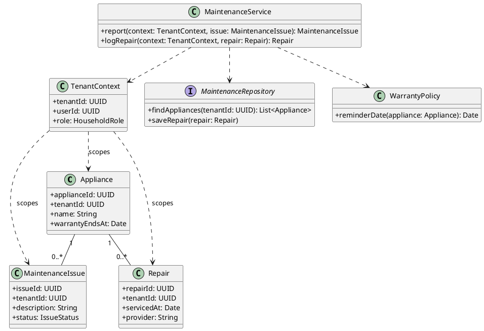
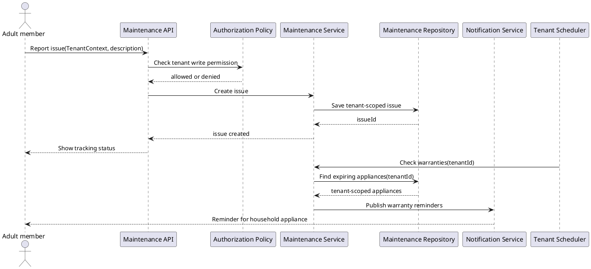
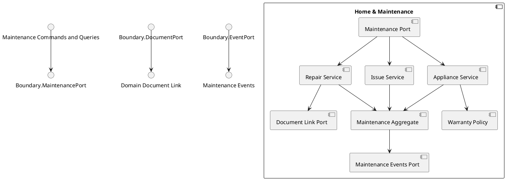

# Home and Maintenance Component

## Story coverage

- US-5.1: log a repair and service history.
- US-5.2: warranty expiration reminders.
- US-5.3: report and track a maintenance issue.

## Component diagram

## Responsibilities and rules

- `Issue Handler` tracks description, reporter, status, priority, and accountable member.
- `Repair Handler` records service date, provider, cost, notes, and related appliance.
- `Appliance Handler` stores warranty and appliance details.
- `Warranty Policy` calculates reminder dates and emits a domain event rather than sending a notification directly.

The component owns maintenance history and warranty data; documents are linked through a document port when invoices or warranty certificates are uploaded.

## Tenant-aware class structure

Appliances, issues, and repairs are tenant-owned records. Warranty jobs must be scheduled per tenant and load appliances through a tenant-filtered repository.

## Behavior diagram: maintenance issue and warranty reminder

The scheduler supplies a tenant explicitly; it never scans appliances across tenants through a global unfiltered query.

## Internal structure

Issue tracking, repair history, appliance data, and warranty calculation are separate internal components. The aggregate remains the single owner of maintenance state and emits events for reminders.
