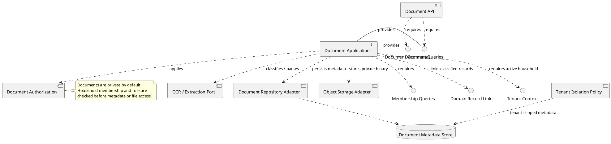
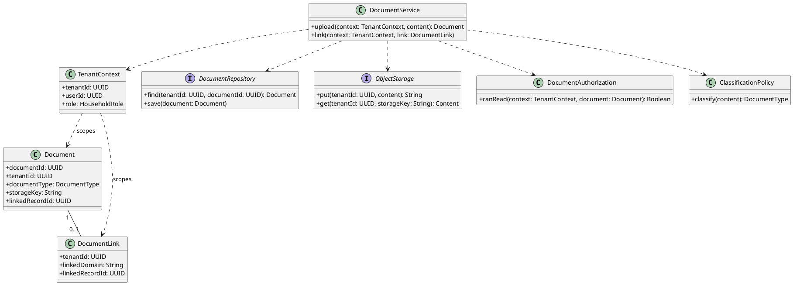
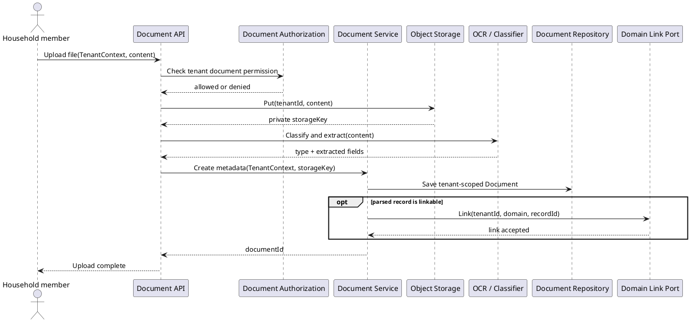
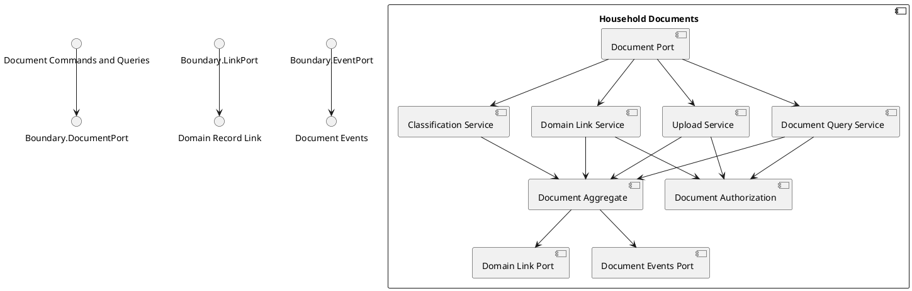

# Household Documents Component

## Story coverage

- US-6.1: upload bills, warranties, receipts, photos, and PDFs.
- US-4.1: parse a receipt and link it to an expense.
- US-5.2: support warranty evidence and reminders.

## Component diagram

## Responsibilities and rules

- `Upload Handler` validates file type and size, stores the binary privately, and creates metadata.
- `Classification Handler` identifies receipt, bill, warranty, or other household document and requests OCR/extraction through a port.
- `Document Link Handler` links parsed data to a domain record without owning that record.
- `Document Query Handler` applies household and role filtering to metadata and download access.

The component owns document metadata and storage references. It does not directly create expenses, maintenance records, or bills; it emits a classified-document command for the owning component.

## Tenant-aware class structure

Both document metadata and object-storage keys are tenant-scoped. The storage adapter must require `tenantId`, preventing a valid document key from one household being used to retrieve another household's file.

## Behavior diagram: upload and classify a document

The tenant context controls both metadata persistence and binary storage. Classification may suggest a domain link, but the owning domain remains responsible for creating its record.

## Internal structure

The internal structure separates upload, querying, classification, and linking. Storage and OCR remain replaceable adapters behind the public document port and are not allowed to create domain records directly.
