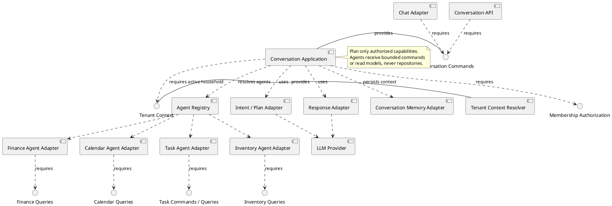
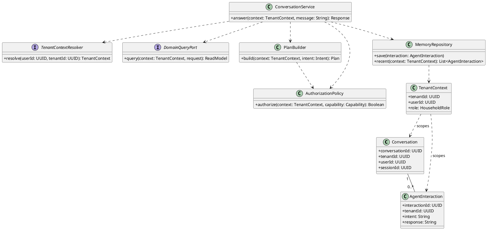
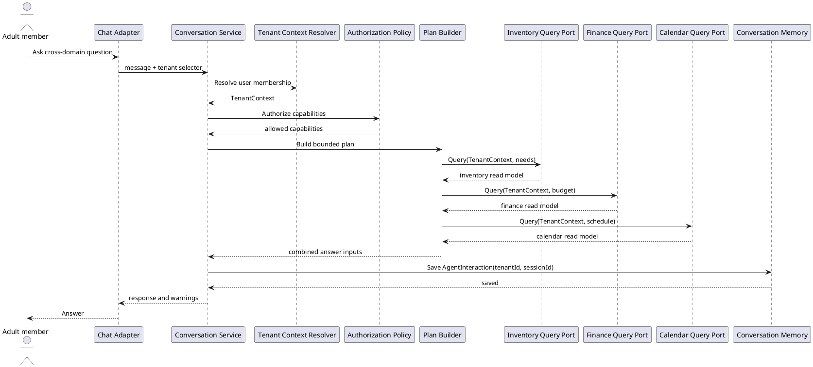
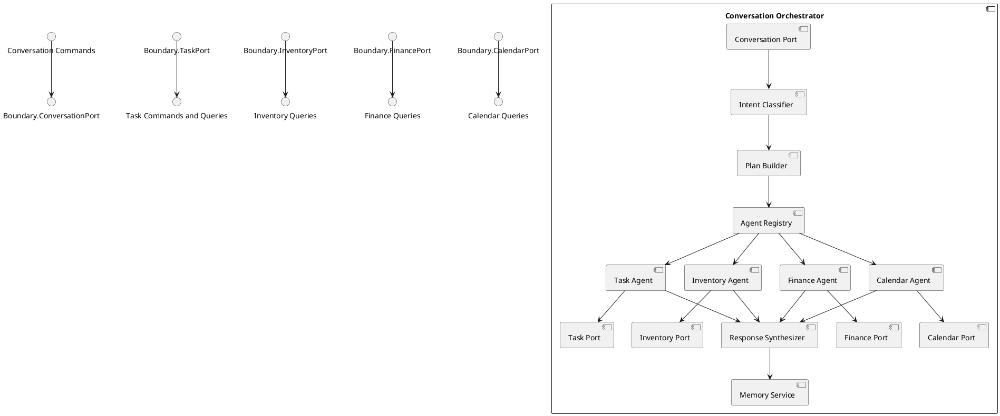

# Conversation and Cross-Domain Orchestrator Component

## Story coverage

- US-2.1: convert a chat request into a task command.
- US-3.2: answer what is running low.
- US-4.2: answer budget questions.
- US-6.2: combine Inventory, Finance, and Calendar information.
- US-6.3: persist recent conversational context.

## Component diagram

## Responsibilities and rules

- `Intent Classifier` identifies task, inventory, finance, calendar, or cross-domain intent.
- `Plan Builder` creates a small execution plan and rechecks authorization for every capability.
- Agents translate language into domain commands or bounded read queries; they do not own domain state.
- `Response Synthesizer` combines results and clearly reports unavailable or denied information.
- `Conversation Memory` persists `AgentInteraction` records scoped to the user, household, and session.

The orchestrator depends on ports, not domain repositories. This keeps LLM behavior replaceable and prevents prompt-driven code from bypassing RBAC.

## Tenant-aware class structure

The active tenant is resolved before planning and passed to every agent port. Conversation memory is keyed by both `tenantId` and `sessionId`, so context from one household cannot leak into another household's answer.

## Behavior diagram: cross-domain question

The orchestrator authorizes the plan before calling any domain port and passes the same tenant context to every query, preventing cross-household synthesis or memory leakage.

## Internal structure

The internal structure keeps planning, agent selection, domain adapters, response synthesis, and memory separate. Each agent requires only its own narrow interface, so adding a new domain agent does not change existing domain components.
