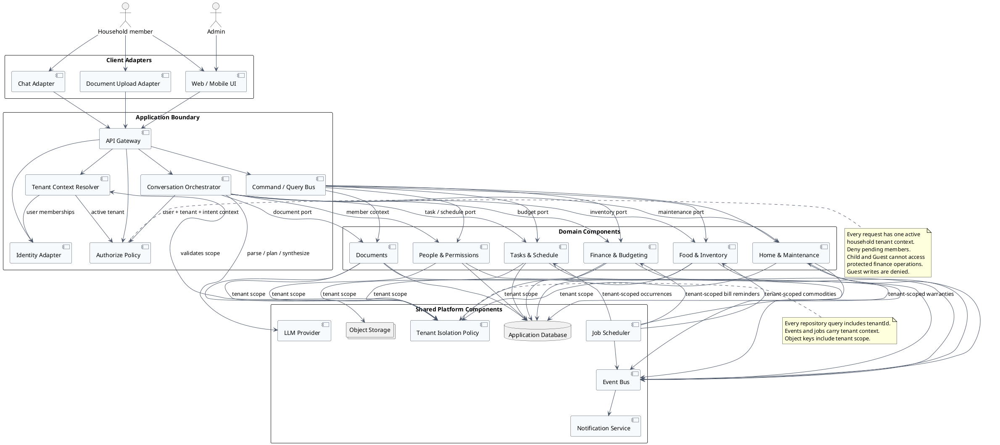
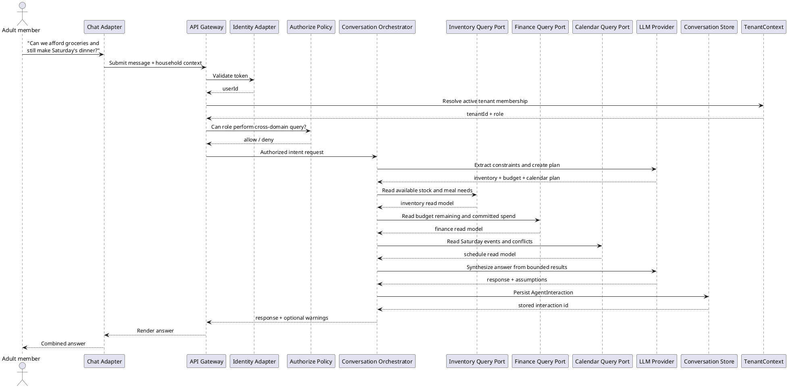

# AI Home Manager - Component Architecture

## 1. Design Intent

This design decomposes the user stories into independently owned components while keeping the system small enough for an MVP. The architecture uses a modular monolith boundary first: components are deployable together, but communicate through application ports and domain events. A component can later become a service without changing the domain contracts.

The system has four architectural rules:

1. **Authorization is a first-class application concern.** Every command and query enters through an authenticated application use case. Role checks happen before a domain agent is called or sensitive data is read.
2. **Agents orchestrate language, not business ownership.** Task, Inventory, Finance, Calendar, Maintenance, and Document agents translate requests and call domain ports. They do not own other domains' data.
3. **Domains own their invariants.** For example, Household Membership protects the last-admin rule, Tasks validates assignees and recurrence, and Finance protects financial visibility.
4. **Cross-domain reasoning is composed at the orchestration boundary.** The orchestrator requests narrow read models from domain ports and synthesizes a response; domains do not call each other directly.

## Multi-tenant boundary

Each household is a tenant. A user may create multiple households or belong to multiple households, but every request executes within exactly one active `tenantId`.

- `Identity Adapter` authenticates the user; `Tenant Context Resolver` selects an active tenant only from memberships that belong to that user.
- `TenantContext(userId, tenantId, role)` is required by commands, queries, domain agents, events, scheduled jobs, and document storage operations.
- Every tenant-owned record includes `tenantId`; repositories and read models require tenant context and apply filtering at the persistence boundary.
- Authorization evaluates both the active tenant membership and the role. A client-supplied `tenantId` is only a selector, never proof of access.
- Tenant-scoped unique keys and idempotency keys prevent collisions between households.
- Background jobs iterate tenants explicitly and create a tenant context for each execution; no job uses an ambient global tenant.
- A shared database is acceptable for the modular monolith, provided row-level tenant filtering is mandatory. Separate databases can be introduced later without changing domain ports.

## 2. System Component Diagram

### Component responsibilities

| Component | Owns | Does not own |
|---|---|---|
| Client adapters | Forms, chat input, upload selection, display state | Authorization decisions or domain rules |
| API Gateway | Transport, request validation, correlation IDs | Business workflows |
| Identity Adapter | Authentication and token identity | Household roles and membership rules |
| Tenant Context Resolver | Selects the active household tenant from authenticated memberships | Trusting a client-supplied tenant without membership validation |
| Tenant Isolation Policy | Enforces tenant scope for repositories, read models, events, jobs, and storage | UI-only filtering or ambient global tenant state |
| Authorize Policy | Permission checks from identity, household, role, and action | Persistence or UI hiding |
| Command / Query Bus | Dispatching explicit application requests | Domain state or agent reasoning |
| Conversation Orchestrator | Intent detection, planning, agent coordination, response synthesis, conversation context | Domain records and domain invariants |
| Domain components | Their aggregates, use cases, repositories, and read models | Direct calls to another domain's database |
| Event Bus | Asynchronous domain-event delivery | Transactional business decisions |
| Scheduler | Time-based recurring work and reminders | Deciding whether a user is allowed to perform an action |
| Notification Service | Delivery through configured channels | Deciding what a domain event means |

## 3. Internal Domain Component Diagram

The domain components share the same application shape. Each domain exposes use-case ports to the bus and narrow query ports to the orchestrator. Repositories and external adapters remain behind the domain's infrastructure boundary.

```plantuml
@startuml
skinparam componentStyle uml2
skinparam shadowing false
skinparam packageStyle rectangle
skinparam ArrowColor #4a5568

package "Application Layer" {
  component "Use-case handlers" as Handlers
  component "Authorization port" as AuthPort
  component "Domain query ports" as QueryPorts
}

package "People & Permissions" {
  component "Household Membership\nuse cases" as Membership
  component "Role Policy" as RolePolicy
  component "Membership Repository" as MembershipRepo
}

package "Tasks & Schedule" {
  component "Task use cases" as TaskCases
  component "Recurrence Policy" as Recurrence
  component "Schedule Conflict Policy" as Conflict
  component "Task Repository" as TaskRepo
}

package "Food & Inventory" {
  component "Inventory use cases" as InventoryCases
  component "Grocery List Policy" as Grocery
  component "Commodity Recurrence Policy" as Commodity
  component "Inventory Repository" as InventoryRepo
}

package "Finance & Budgeting" {
  component "Finance use cases" as FinanceCases
  component "Budget Policy" as Budget
  component "Expense / Bill Repository" as FinanceRepo
}

package "Home & Maintenance" {
  component "Maintenance use cases" as MaintenanceCases
  component "Warranty Policy" as Warranty
  component "Maintenance Repository" as MaintenanceRepo
}

package "Documents" {
  component "Document use cases" as DocumentCases
  component "Document Classification Port" as Classifier
  component "Document Repository" as DocumentRepo
  component "Object Storage Port" as StoragePort
}

Handlers --> AuthPort
Handlers --> Membership
Handlers --> TaskCases
Handlers --> InventoryCases
Handlers --> FinanceCases
Handlers --> MaintenanceCases
Handlers --> DocumentCases
QueryPorts --> Membership
QueryPorts --> TaskCases
QueryPorts --> InventoryCases
QueryPorts --> FinanceCases
QueryPorts --> MaintenanceCases

Membership --> RolePolicy
Membership --> MembershipRepo
TaskCases --> Recurrence
TaskCases --> Conflict
TaskCases --> TaskRepo
InventoryCases --> Grocery
InventoryCases --> Commodity
InventoryCases --> InventoryRepo
FinanceCases --> Budget
FinanceCases --> FinanceRepo
MaintenanceCases --> Warranty
MaintenanceCases --> MaintenanceRepo
DocumentCases --> Classifier
DocumentCases --> DocumentRepo
DocumentCases --> StoragePort

note bottom
  Dependencies point toward policies and ports.
  Domain code never depends on an HTTP controller,
  LLM SDK, concrete database driver, or another domain database.
end note
@enduml
```

### Domain ownership and story mapping

| Domain component | Primary stories | Key invariants |
|---|---|---|
| People & Permissions | US-1.1 to US-1.7 | First user becomes Admin; pending invitees have no access; only Admin approves roles; transfer requires confirmation; last Admin cannot be removed. |
| Tasks & Schedule | US-2.1 to US-2.6 | Assignees belong to the household; manual and chat entry use the same task command; recurrence creates occurrences; calendar writes detect overlap. |
| Food & Inventory | US-3.1 to US-3.6 | Stock thresholds are respected; recurring commodities generate grocery occurrences; purchase completion updates stock and can attach cost. |
| Finance & Budgeting | US-4.1 to US-4.4 | Financial reads and writes require policy approval; expenses link to documents; budgets include eligible recurring purchases; bill reminders are scheduled. |
| Home & Maintenance | US-5.1 to US-5.3 | Repairs retain service history; warranty dates can trigger reminders; requests have an accountable status and owner. |
| Documents | US-6.1 and US-4.1 | Uploads are stored safely; classification is explicit; parsed documents link to a tenant-scoped domain record without granting access beyond the caller's role. |
| Conversation Orchestrator | US-2.1, US-3.2, US-4.2, US-6.2, US-6.3 | Plans are authorized before execution; each agent receives only the required tenant context; conversation memory is scoped to tenant, user, and session. |

## 4. Cross-Domain Request Flow

This flow shows the highest-risk path: a cross-domain question that combines inventory, finance, and schedule data. The orchestrator uses read-only ports and cannot bypass authorization.

## 5. SOLID Decisions

### Single Responsibility Principle

- The API Gateway handles transport concerns.
- Authorize Policy handles access decisions.
- The orchestrator handles language-driven planning.
- Each domain component handles only its own business state and invariants.
- Notifications and scheduling are platform capabilities, not hidden inside domain entities.

### Open/Closed Principle

- New input channels can implement the same command/query ports without changing domain code.
- New notification channels can implement the notification port without changing event producers.
- New agents can be added behind an agent capability registry.
- Recurrence uses a policy interface so daily, weekly, and custom schedules can be added without changing task or commodity aggregates.

### Liskov Substitution Principle

- Every adapter must honor the contract of its port, including validation and error semantics.
- Read-only query ports must not unexpectedly mutate inventory, finance, or schedule state.
- A notification provider can replace another provider without changing event consumers.

### Interface Segregation Principle

- The orchestrator receives narrow read ports, not complete repositories.
- UI clients use task commands and task queries separately.
- Document classification, object storage, identity, and notification integrations have separate ports.
- Admin operations are not exposed through the general member interface.

### Dependency Inversion Principle

- Use-case handlers depend on repository and integration interfaces.
- Domain code does not depend on HTTP, SQL, an LLM SDK, or a cloud storage SDK.
- Infrastructure implements ports at the composition root.
- Cross-domain reasoning depends on read-model contracts rather than concrete domain classes.

## 6. Security and Consistency Rules

1. Resolve `userId` from the authenticated token and resolve `tenantId` and role from an active membership; never trust these values from form fields or chat text.
2. Check tenant membership and action permission before invoking an agent or domain handler.
3. Treat pending invitees as authenticated but unauthorized for tenant resources.
4. Require tenant scope in every repository, read model, event, job, and object-storage operation.
5. Enforce Child and Guest finance restrictions in application handlers and domain policies, not only in the client.
6. Use an outbox or equivalent transaction boundary when publishing tenant-scoped events after a domain change, so notifications cannot be sent for a rolled-back change.
7. Make recurring job execution idempotent using `tenantId`, recurrence rule, and occurrence date.
8. Keep uploaded documents private by default and include `tenantId` in storage authorization and object-key resolution.
9. Redact sensitive finance data from orchestrator prompts when the caller is not authorized to see it.

## 7. Implementation Sequence

1. Build People & Permissions with household tenants, multi-membership, pending invites, roles, tenant switching, and admin transfer.
2. Add the shared application boundary: identity, authorization policy, command/query contracts, and error model.
3. Implement Tasks & Schedule with both manual and chat commands backed by one task use case.
4. Implement Inventory with low-stock queries, grocery lists, and recurring commodities.
5. Add Finance read models and enforce finance authorization before agent execution.
6. Add the orchestrator, bounded cross-domain query ports, and conversation memory.
7. Add Documents, notifications, scheduler, and remaining maintenance workflows.

This order keeps the security foundation ahead of agent behavior and allows the MVP to run as one deployable application while preserving clear extraction boundaries.
