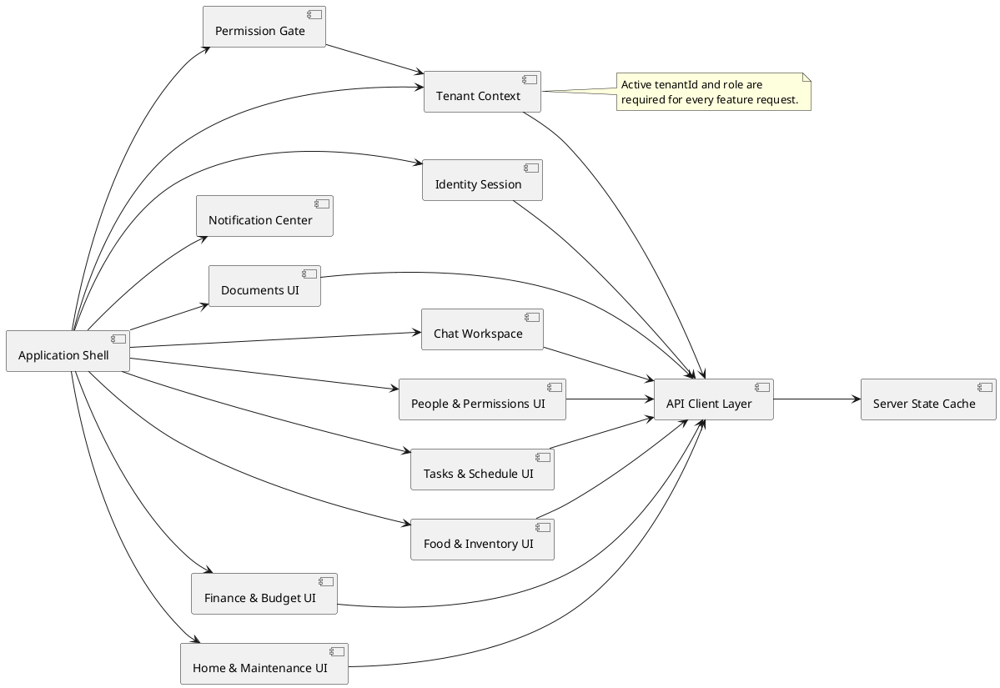

# Frontend Architecture

## Architecture style

Use a feature-oriented frontend organized around the same bounded components as the backend. The initial implementation can be one web application, but feature modules must communicate through typed API clients and domain view models rather than importing each other's stores.



## Frontend layers

| Layer | Responsibility | Rule |
|---|---|---|
| Application shell | Routing, tenant switcher, global notifications, responsive navigation | Does not own domain records |
| Feature UI | Screens, forms, tables, cards, local interaction state | Uses feature API hooks/view models |
| API client layer | Authentication headers, tenant headers/routes, typed requests, error normalization | Never trusts client role for security |
| Server state cache | Requests, cache invalidation, optimistic updates where safe | Cache keys always include `tenantId` |
| Permission gate | Hide or disable unavailable actions and render forbidden states | Backend remains authoritative |
| Design system | Buttons, forms, dialogs, tables, alerts, loading and empty states | Accessible by default |

## Tenant context

The shell owns the active tenant selector. It stores only the selected `tenantId`, not authorization claims as truth. On selection:

1. Fetch or resolve the user's membership for that tenant.
2. Replace the active `TenantContext`.
3. Invalidate tenant-scoped server-state queries.
4. Cancel or ignore in-flight requests for the previous tenant.
5. Load the new dashboard and navigation permissions.

Every query key and mutation includes `tenantId`. A stale response from tenant A must never render after switching to tenant B.

## Permission-aware rendering

The UI consumes a capability map such as:

```json
{
  "tenantId": "uuid",
  "role": "Adult",
  "capabilities": {
    "tasks.create": true,
    "finance.read": true,
    "members.manage": false
  }
}
```

Use capabilities to control navigation, actions, and form availability. If an API returns `403`, render a clear access state and remove/disable the action for the current view; do not retry or expose cached protected data.

## Feature boundaries

- **People & Permissions UI:** household creation, invite join, pending member review, role changes, Admin transfer, tenant switcher.
- **Tasks & Schedule UI:** assigned-task list, task form, chat-created task confirmation, recurrence, calendar, conflict warnings.
- **Food & Inventory UI:** low-stock view, grocery list, commodity recurrence, purchase completion, stock updates.
- **Finance & Budget UI:** budget status, expense review, receipt upload status, recurring bills. Not rendered for Child or Guest.
- **Home & Maintenance UI:** issue reporting, repair history, appliances, warranty status.
- **Documents UI:** upload, classification status, linked record, private preview/download.
- **Chat Workspace:** conversation history, agent progress, structured action confirmation, cross-domain answer.
