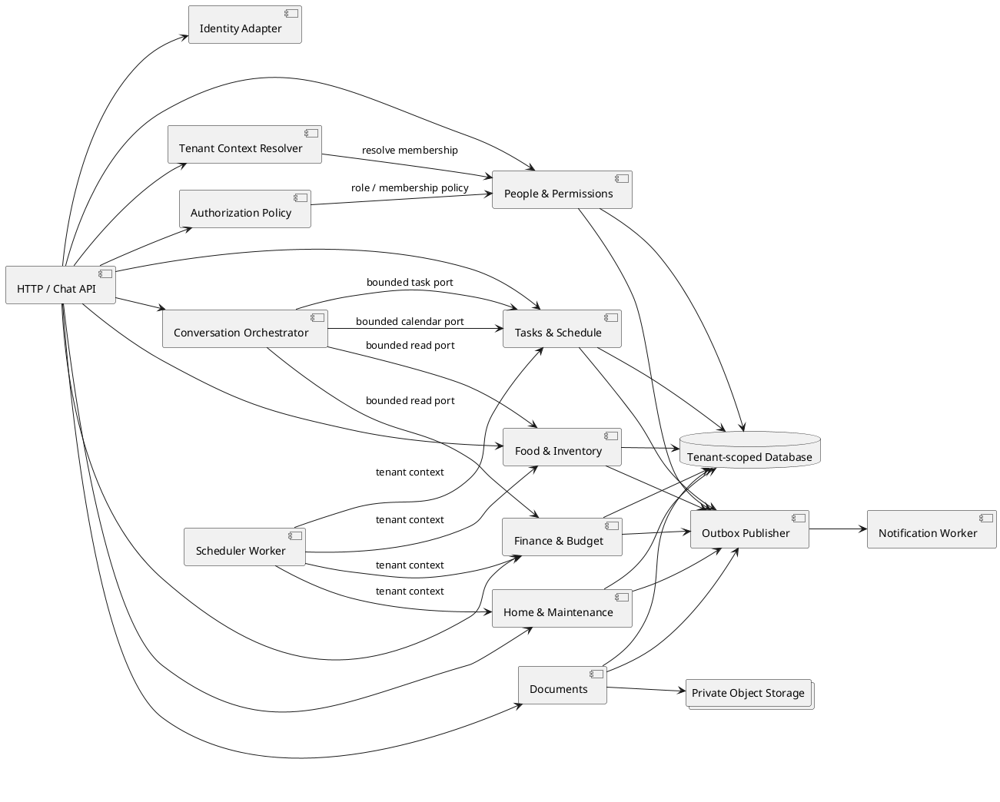
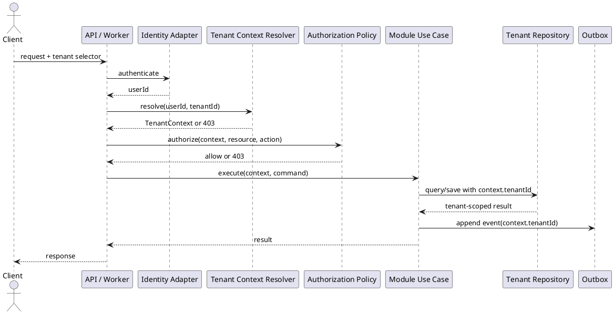

# AI Home Manager Backend Design Plan

## 1. Purpose and scope

This plan turns the user stories and component designs into an implementable backend. The initial deployment is a modular monolith with strict module boundaries. Modules communicate through application contracts, ports, and tenant-scoped domain events; no module reads another module's tables directly.

The plan supports multiple household tenants. A user may create or join multiple households, but each request operates in one active tenant context:

```text
TenantContext = { userId, tenantId, membershipId, role, correlationId }
```

The backend must reject a request when the authenticated user does not have an active membership in the selected tenant.

## 2. Backend component map

The implementation maps directly to the component files in [`docs/design/components`](../design/components/README.md).



### Module ownership

| Module | Owns | Exposes |
|---|---|---|
| People & Permissions | Users, household tenants, memberships, invites, roles, permission policy | Registration, invitation, approval, role management, tenant context, authorization queries |
| Tasks & Schedule | Tasks, calendar events, recurrence rules, conflict checks | Task commands, assigned-task queries, calendar queries |
| Food & Inventory | Stock, grocery items, commodity rules, purchase occurrences | Inventory queries, grocery commands, commodity commands |
| Finance & Budget | Expenses, budgets, recurring bills, finance authorization | Expense commands, budget queries, bill commands |
| Home & Maintenance | Appliances, repairs, issues, warranties | Maintenance commands, warranty queries |
| Documents | Document metadata, classification, private storage references | Upload, document query, domain-link contracts |
| Conversation Orchestrator | Intent, plan, bounded agent calls, conversation memory | Chat command and response contract |
| Shared platform | Identity, tenant resolution, outbox, notifications, scheduling | Infrastructure ports only |

## 3. Request pipeline and tenant security

Every HTTP, chat, upload, and worker request follows this order:

1. Validate authentication and produce `userId`.
2. Read the requested tenant selector from route/header/message metadata.
3. Resolve an active membership for `(userId, tenantId)`.
4. Build immutable `TenantContext`.
5. Authorize the operation using tenant role, resource, and action.
6. Validate the command and execute the owning module use case.
7. Apply tenant filters in repositories and object storage adapters.
8. Publish tenant-scoped events through an outbox after commit.

Never accept `tenantId`, role, or user identity from a form field or natural-language message as authoritative. The selected tenant is a selector; membership resolution is the authorization source.



## 4. API plan

All endpoints are tenant-scoped. Recommended route convention:

```text
/api/v1/tenants/{tenantId}/...
```

The server still resolves and verifies membership; the route parameter is not trusted by itself.

### People and permissions

| Method | Endpoint | Permission | Story |
|---|---|---|---|
| POST | `/api/v1/households` | Authenticated user | US-1.1 |
| GET | `/api/v1/households` | Authenticated user | Multi-household tenant selection |
| POST | `/api/v1/households/{tenantId}/invites` | Admin | US-1.2 |
| POST | `/api/v1/households/{tenantId}/join` | Authenticated user | US-1.2 |
| GET | `/api/v1/households/{tenantId}/members/pending` | Admin | US-1.3 |
| POST | `/api/v1/households/{tenantId}/members/{userId}/approve` | Admin | US-1.3 |
| POST | `/api/v1/households/{tenantId}/members/{userId}/reject` | Admin | Pending lifecycle |
| PATCH | `/api/v1/households/{tenantId}/members/{userId}/role` | Admin | US-1.4 |
| POST | `/api/v1/households/{tenantId}/admin-transfers` | Admin | US-1.5 |
| POST | `/api/v1/households/{tenantId}/admin-transfers/{transferId}/confirm` | Target Adult | US-1.5 |
| GET | `/api/v1/households/{tenantId}/members/me` | Active member | US-1.6, US-1.7 |

### Tasks and schedule

| Method | Endpoint | Permission | Story |
|---|---|---|---|
| POST | `/api/v1/tenants/{tenantId}/tasks` | Adult/Admin | US-2.2 |
| GET | `/api/v1/tenants/{tenantId}/tasks?assignedTo=me` | Active member | US-2.3 |
| PATCH | `/api/v1/tenants/{tenantId}/tasks/{taskId}` | Resource policy | Task management |
| POST | `/api/v1/tenants/{tenantId}/recurrence-rules` | Admin | US-2.4 |
| GET | `/api/v1/tenants/{tenantId}/calendar` | Active member | US-2.5 |
| POST | `/api/v1/tenants/{tenantId}/calendar/events` | Adult/Admin | US-2.6 |

Chat-created tasks use `POST /api/v1/tenants/{tenantId}/conversations/messages`; the Task Agent must produce the same `CreateTask` command used by the manual endpoint.

### Food and inventory

| Method | Endpoint | Permission | Story |
|---|---|---|---|
| GET | `/api/v1/tenants/{tenantId}/inventory/low-stock` | Active member | US-3.1, US-3.2 |
| POST | `/api/v1/tenants/{tenantId}/grocery-items` | Active member | US-3.3, US-3.4 |
| PATCH | `/api/v1/tenants/{tenantId}/grocery-items/{itemId}` | Active member | US-3.4 |
| POST | `/api/v1/tenants/{tenantId}/commodity-rules` | Adult/Admin | US-3.5 |
| POST | `/api/v1/tenants/{tenantId}/purchase-occurrences/{id}/complete` | Active member | US-3.6 |

### Finance, maintenance, and documents

| Method | Endpoint | Permission | Story |
|---|---|---|---|
| POST | `/api/v1/tenants/{tenantId}/documents` | Active member | US-6.1 |
| POST | `/api/v1/tenants/{tenantId}/expenses` | Adult/Admin | US-4.1 |
| GET | `/api/v1/tenants/{tenantId}/budgets/{category}/status` | Adult/Admin | US-4.2 |
| POST | `/api/v1/tenants/{tenantId}/bills` | Admin | US-4.3 |
| POST | `/api/v1/tenants/{tenantId}/maintenance/issues` | Adult | US-5.3 |
| POST | `/api/v1/tenants/{tenantId}/maintenance/repairs` | Adult | US-5.1 |
| POST | `/api/v1/tenants/{tenantId}/appliances` | Admin | US-5.2 |

Child and Guest finance requests must return `403` before the Finance module or Finance Agent is invoked.

## 5. Persistence design

Use one SQLite database for the modular-monolith MVP with strict module ownership and tenant filters. Enable foreign keys and WAL mode, keep write transactions short, and enforce tenant isolation in application repositories because SQLite has no Row-Level Security. A future server-database migration or service split can move a module without changing its public port contracts.

### Shared identity and tenancy tables

- `users`: global identity-linked profile; no tenant-owned business data.
- `household_tenants`: `tenant_id`, name, status, created_by, created_at.
- `memberships`: `tenant_id`, `user_id`, role, status, personal details, timestamps.
- `invites`: `tenant_id`, code hash, expiry, status, invited by.
- `admin_transfers`: `tenant_id`, current admin, target adult, confirmation state, expiry.

### Domain tables

Every table below includes `tenant_id`, indexes it, and uses tenant-aware foreign keys where supported:

- Tasks: `tasks`, `recurrence_rules`, `calendar_events`.
- Inventory: `inventory_items`, `grocery_items`, `commodity_rules`, `purchase_occurrences`.
- Finance: `expenses`, `budgets`, `recurring_bills`.
- Maintenance: `appliances`, `maintenance_issues`, `repairs`.
- Documents: `documents`, `document_links`.
- Conversation: `conversations`, `agent_interactions`.
- Platform: `outbox_messages`, `notifications`, `job_runs`.

### Required constraints

- Unique membership: `(tenant_id, user_id)`.
- At most one active Admin invariant per transfer transaction; never commit zero Admins.
- Unique recurrence occurrence: `(tenant_id, recurrence_rule_id, occurrence_date)`.
- Unique document link: `(tenant_id, linked_domain, linked_record_id)` where business rules permit.
- Unique idempotency key: `(tenant_id, idempotency_key)`.
- All domain foreign keys include `tenant_id` to prevent accidental cross-tenant references.

## 6. Domain events and workers

Use an outbox pattern. A module writes its state and an outbox row in one transaction; the publisher delivers events asynchronously.

| Event | Producer | Consumers |
|---|---|---|
| `MembershipApproved` / `MembershipRejected` | People & Permissions | Notifications |
| `RoleChanged` / `AdminTransferred` | People & Permissions | Authorization cache, Notifications |
| `TaskCreated` / `CalendarConflictDetected` | Tasks & Schedule | Notifications, Conversation read models |
| `InventoryLowStock` / `PurchaseCompleted` | Food & Inventory | Notifications, Finance |
| `ExpenseRecorded` / `BillDueSoon` | Finance | Notifications, Budget read models |
| `WarrantyExpiring` / `MaintenanceIssueReported` | Maintenance | Notifications, Documents |
| `DocumentClassified` | Documents | Finance, Maintenance |

Every event envelope includes:

```json
{
  "eventId": "uuid",
  "eventType": "PurchaseCompleted",
  "tenantId": "uuid",
  "actorUserId": "uuid",
  "correlationId": "uuid",
  "occurredAt": "timestamp",
  "schemaVersion": 1,
  "payload": {}
}
```

Workers must be idempotent and must create a `TenantContext` from the event envelope before invoking a module.

## 7. Agent backend design

Agents are adapters around application ports, not owners of domain data.

- **Task Agent:** parse assignee, action, due date, priority, and recurrence into `CreateTask`.
- **Inventory Agent:** call low-stock and grocery query ports; never expose finance data without authorization.
- **Finance Agent:** call budget and expense query ports only after finance authorization.
- **Calendar Agent:** call calendar query/create ports and return conflict warnings.
- **Document Agent:** classify and extract receipt, bill, and warranty data; submit commands to the owning module.
- **Orchestrator:** resolve intent, authorize each capability, execute bounded calls, synthesize a response, and persist tenant-scoped `AgentInteraction`.

Prompt input must contain only the minimum authorized tenant read models. Never send an entire tenant database or another tenant's conversation history to the LLM.

## 8. Implementation phases

### Phase 1: tenancy, identity, and authorization

- Implement users, household tenants, memberships, invites, pending states, roles, and Admin transfer.
- Implement `TenantContextResolver`, centralized `AuthorizationPolicy`, standard `403` errors, and tenant-aware repository base contracts.
- Add integration tests for cross-tenant denial and last-Admin protection.

Covers US-1.1 through US-1.7.

### Phase 2: task and schedule vertical slice

- Implement manual task command, assigned-task query, recurrence, calendar events, and conflict warnings.
- Add chat adapter mapping to the same task command.
- Add tenant-scoped task events and notifications.

Covers US-2.1 through US-2.6.

### Phase 3: inventory and commodity workflow

- Implement inventory, low-stock queries, grocery lists, recurring commodities, idempotent occurrences, and purchase completion.
- Integrate optional purchase cost with Finance through a port.

Covers US-3.1 through US-3.6.

### Phase 4: finance and document workflow

- Implement expenses, budgets, recurring bills, receipt extraction, private document storage, and document links.
- Enforce Child/Guest restrictions before Finance Agent invocation.

Covers US-4.1 through US-4.4 and US-6.1.

### Phase 5: maintenance and cross-domain reasoning

- Implement repairs, issues, appliances, warranty jobs, orchestrator planning, bounded agent ports, and conversation memory.
- Add the cross-domain affordability scenario and tenant-scoped response synthesis.

Covers US-5.1 through US-5.3 and US-6.2 through US-6.3.

## 9. Testing and quality gates

### Unit tests

- Role and permission matrix for every role, resource, and action.
- Household policy: first Admin and last-Admin protection.
- Tenant repository filters and tenant-aware foreign-key validation.
- Task recurrence and calendar overlap policies.
- Inventory thresholds and occurrence idempotency.
- Budget calculation and receipt mapping.
- Warranty reminder date calculation.
- Orchestrator plan authorization and memory scoping.

### Integration tests

- User belongs to tenant A cannot read or mutate tenant B.
- Pending invitee receives `403` for every household resource.
- Guest read succeeds only for allowed schedule/task views; all writes return `403`.
- Child finance endpoints return `403` before Finance Agent invocation.
- Admin transfer commits both role changes atomically.
- Outbox publishes only after a successful transaction.
- Object storage refuses a key outside the active tenant.

### Contract tests

- API adapters satisfy command/query contracts.
- Agent adapters produce valid domain commands.
- Event envelopes always contain `tenantId`, `actorUserId`, correlation ID, and schema version.
- Repository implementations require tenant context.

### Operational checks

- Structured logs include `tenantId` only where permitted and never include secrets or receipt contents.
- Metrics are tagged by module and tenant plan/aggregate, not raw sensitive tenant names.
- Rate limits and upload limits are enforced per user and tenant.
- Audit logs record role changes, Admin transfers, finance access denials, and document access.

## 10. Story traceability

| Story range | Backend modules | Primary acceptance evidence |
|---|---|---|
| US-1.1 to US-1.7 | People & Permissions, Identity, Tenant Context, Authorization | Role matrix, membership lifecycle tests, tenant isolation tests |
| US-2.1 to US-2.6 | Tasks & Schedule, Task Agent, Calendar Agent | Shared task command, recurrence tests, conflict warning tests |
| US-3.1 to US-3.6 | Food & Inventory, Scheduler, Finance port | Threshold tests, occurrence idempotency, inventory update tests |
| US-4.1 to US-4.4 | Finance, Documents, OCR adapter, Authorization | Receipt-link test, budget test, pre-agent `403` test |
| US-5.1 to US-5.3 | Home & Maintenance, Scheduler, Notifications | Repair history, warranty reminder, issue lifecycle tests |
| US-6.1 | Documents, Object Storage, Classification adapter | Private upload, classification, domain-link test |
| US-6.2 to US-6.3 | Conversation Orchestrator, bounded query ports, Memory | Multi-domain plan test, tenant/session memory test |

## 11. Definition of done

A backend slice is complete when:

- Its owning module has commands, queries, policies, ports, persistence, and tests.
- Every tenant-owned operation requires `TenantContext`.
- Authorization is tested at the application boundary and in the domain policy.
- Events are emitted through the outbox with a versioned tenant-aware envelope.
- API and agent inputs converge on the same use case where behavior is shared.
- Failure responses are consistent (`400` validation, `401` unauthenticated, `403` unauthorized, `404` tenant-scoped not found, `409` conflict, `422` domain rule violation).
- Documentation and component diagrams remain synchronized with the implementation.
